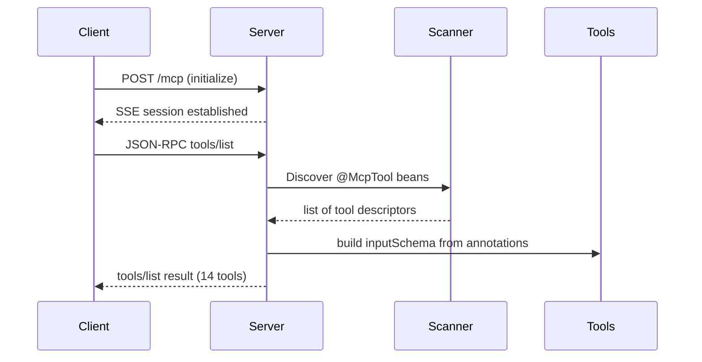
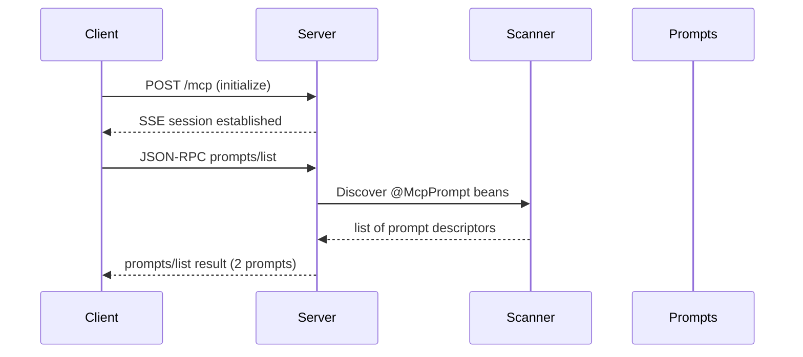
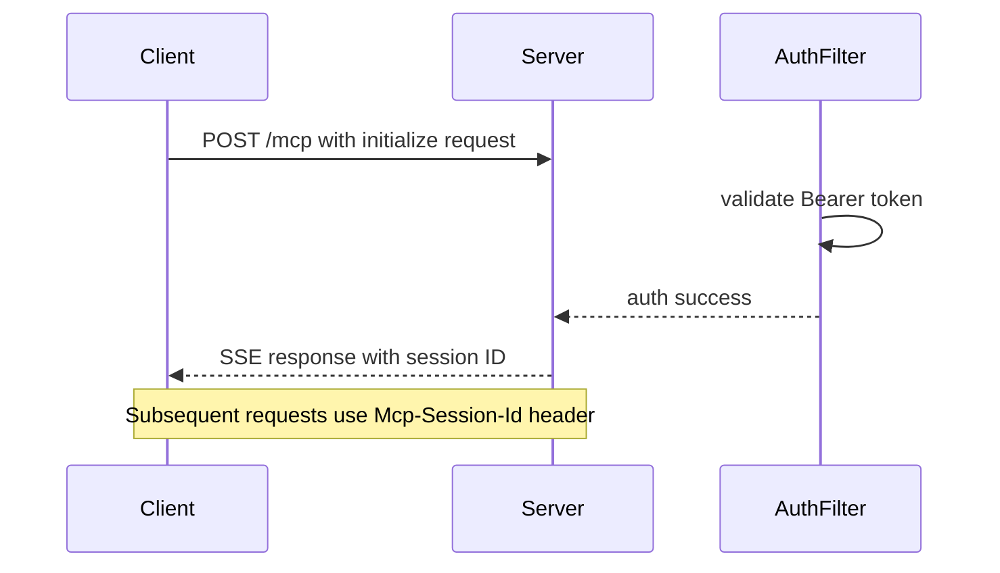
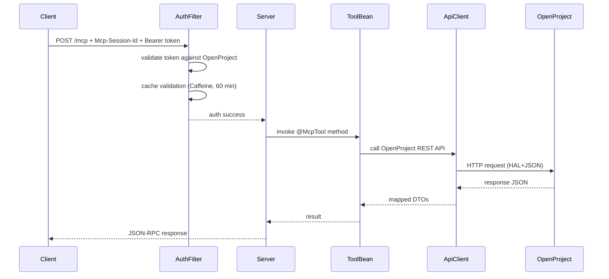
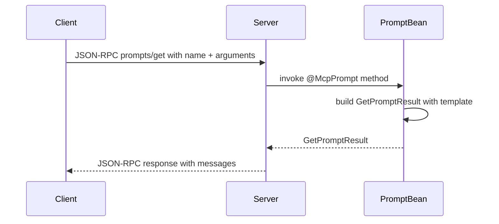

# MCP Protocol Layer

The MCP (Model Context Protocol) layer is the external-facing boundary of the
`openproject-mcp-server` application. It exposes OpenProject data and operations
to MCP clients (e.g. AI assistants) through a Spring AI MCP server running over
HTTP with the SSE transport.

## Configuration and Transport

The server is configured in
[application.properties](../../src/main/resources/application.properties):

```properties
spring.ai.mcp.server.enabled=true
spring.ai.mcp.server.name=openproject-mcp-server
spring.ai.mcp.server.version=1.2.0
spring.ai.mcp.server.protocol=sse
spring.ai.mcp.server.capabilities.tool=true
spring.ai.mcp.server.type=sync
spring.ai.mcp.server.annotation-scanner.enabled=true
```

Key configuration points:

- **Protocol**: `sse` is the production transport. The server listens on `/mcp`
  (JSON-RPC endpoint) and `/sse` (SSE server-sent events endpoint). Tests
  override this to `STREAMABLE` to avoid keeping open HTTP streams during test
  execution
  [McpToolsListIntegrationTest][src/test/java/de/tklein/tklab/openproject/mcp/tools/McpToolsListIntegrationTest.java].
- **Sync type**: `sync` means tool invocations are handled synchronously within
  the HTTP request lifecycle, not on background threads.
- **Annotation scanner**: Enabled so that `@McpTool` and `@McpPrompt`
  annotations on Spring `@Component` beans are auto-discovered at startup.

## Tool Registration

All tool beans are `@Component` classes in the
`de.tklein.tklab.openproject.mcp.tools` package. Spring AI's annotation scanner
discovers them at startup and registers each `@McpTool`-annotated method as an
MCP tool with the server.

### Tool Classes

There are six tool classes:

1. **PriorityTools** — provides `priorityList()` to retrieve available priority
   values from OpenProject
   [PriorityTools][src/main/java/de/tklein/tklab/openproject/mcp/tools/PriorityTools.java].
2. **ProjectTools** — provides `projectList()` and the prompt
   `openproject.project.summary`
   [ProjectTools][src/main/java/de/tklein/tklab/openproject/mcp/tools/ProjectTools.java].
3. **RelationTools** — provides six tools for work package relations:
   `relationAllowedValues()`, `relationList()`, `relationAdd()`,
   `relationDelete()`, `relationAddParent()`, `relationDeleteParent()`
   [RelationTools][src/main/java/de/tklein/tklab/openproject/mcp/tools/RelationTools.java].
   The `RelationType` enum defines six relation kinds: `relates`, `blocks`,
   `precedes`, `duplicates`, `includes`, `requires`.
4. **TypesTools** — provides `typeList(projectId)` to list allowed work package
   types for a given project
   [TypesTools][src/main/java/de/tklein/tklab/openproject/mcp/tools/TypesTools.java].
5. **WorkPackageTools** — the most feature-rich tool class with seven tools:
   `workPackageList()`, `workPackageShow()`, `workPackageCreate()`,
   `workPackageUpdate()`, `workPackageUploadAttachment()`, plus the prompt
   `openproject.workpackage.safe_edit`
   [WorkPackageTools][src/main/java/de/tklein/tklab/openproject/mcp/tools/WorkPackageTools.java].
6. **Common** — provides `handleLoggingMessage()` for MCP client log
   notifications, tagged with `@McpLogging(clients = "openproject-mcp-server")`
   [Common][src/main/java/de/tklein/tklab/openproject/mcp/tools/Common.java].

### Tool Annotations

Each tool method carries `@McpTool(description = "...")` which defines the tool
name (derived from the method name) and its human-readable description. The
`annotations = @McpAnnotations(readOnlyHint = true)` flag marks read-only tools
so MCP clients can optimize their behavior.

Validation is handled via `@Validated` on the class level and
`@NotNull`/`@JsonProperty` annotations on parameters. Spring AI converts these
into the tool's `inputSchema` (JSON Schema) that appears in `tools/list`
responses.

### JSON-RPC `tools/list` Flow



The `tools/list` response contains all 14 tool descriptors, each with `name`,
`description`, and `inputSchema`
[McpToolsListIntegrationTest][src/test/java/de/tklein/tklab/openproject/mcp/tools/McpToolsListIntegrationTest.java].

### JSON-RPC `prompts/list` Flow



Two prompts are registered:

- **`openproject.project.summary`** — takes `projectId` and `projectName`
  arguments, returns a `GetPromptResult` with an assistant message template
  [ProjectTools][src/main/java/de/tklein/tklab/openproject/mcp/tools/ProjectTools.java].
- **`openproject.workpackage.safe_edit`** — takes `workPackageId` and
  `requestedChange` arguments, returns a detailed system prompt that instructs
  the AI assistant to follow a diff-then-confirm workflow for safe work package
  updates, including lockVersion concurrency handling and Markdown newline
  conventions
  [WorkPackageTools][src/main/java/de/tklein/tklab/openproject/mcp/tools/WorkPackageTools.java].

## JSON-RPC Initialization

The MCP protocol requires a client to call `initialize` before using any other
method. The flow is:



The client sends a JSON-RPC 2.0 `initialize` request to `/mcp` with:
- `protocolVersion`: `"2024-11-05"`
- `capabilities`: client capabilities object
- `clientInfo`: `{ name, version }`

The server responds over the SSE stream with:
- A `Mcp-Session-Id` HTTP header (required for all subsequent requests)
- A JSON-RPC response containing the server's protocol version, capabilities,
  and server info

After initialization, all subsequent JSON-RPC calls must include the
`Mcp-Session-Id` header
[McpToolsHelper][src/test/java/de/tklein/tklab/openproject/mcp/tools/McpToolsHelper.java].

## JSON-RPC `tools/call` Flow

When a client calls a tool:



Each tool method delegates to `OpenProjectApiClient`, which uses `RestClient`
with HAL+JSON content negotiation to call the OpenProject REST API v3
[OpenProjectApiClient][src/main/java/de/tklein/tklab/openproject/mcp/openproject/client/OpenProjectApiClient.java].
The `OpenProjectRestClientFactory` builds the `RestClient` per request by
resolving the connection details (base URL and authorization header) from the
current HTTP request
[OpenProjectRestClientFactory][src/main/java/de/tklein/tklab/openproject/mcp/openproject/client/OpenProjectRestClientFactory.java].

## JSON-RPC `prompts/get` Flow

When a client retrieves a prompt:



The prompt methods are regular Spring beans — they receive arguments from the
client, apply them to a string template, and return a `GetPromptResult`
containing a list of `PromptMessage`s. The `safe_edit` prompt returns a
comprehensive system prompt that enforces a diff-then-confirm workflow with
lockVersion-based concurrency control
[WorkPackageTools][src/main/java/de/tklein/tklab/openproject/mcp/tools/WorkPackageTools.java].

## JSON-RPC `ping`

The `ping` method is a standard MCP health check. The server responds with an
empty result object
[McpPingIntegrationTest][src/test/java/de/tklein/tklab/openproject/mcp/tools/McpPingIntegrationTest.java].

## Authentication and Security

The MCP layer sits behind two Spring Security filter chains:

1. **Actuator chain** (`/actuator/**`) — basic auth with admin role for health
   endpoints
   [SecurityConfig][src/main/java/de/tklein/tklab/openproject/mcp/security/SecurityConfig.java].
2. **MCP chain** (`/mcp/**`, `/sse`) — Bearer token authentication via
   `McpBearerAuthenticationFilter`

### Bearer Token Flow

`McpBearerAuthenticationFilter` extends `OncePerRequestFilter` and intercepts
all `/mcp` and `/sse` requests:

1. Extracts the Bearer token from the `Authorization` header
   [McpBearerAuthenticationFilter][src/main/java/de/tklein/tklab/openproject/mcp/security/McpBearerAuthenticationFilter.java].
2. Delegates to `OpenProjectTokenValidator` which:
   - Resolves the OpenProject base URL via `OpenProjectConnectionResolver`
   - Hashes `baseUrl|token` with SHA-256 as a cache key
   - Checks `OpenProjectTokenValidationCache` (Caffeine, 60 min TTL)
   - On cache miss, calls `OpenProjectApiClient.root()` to validate the token
     against OpenProject's `/api/v3` endpoint
   - Caches the result keyed by the token hash
   [OpenProjectTokenValidator][src/main/java/de/tklein/tklab/openproject/mcp/security/OpenProjectTokenValidator.java].
3. Sets a `UsernamePasswordAuthenticationToken` with role `ROLE_MCP_USER` in
   `SecurityContextHolder` and saves the context via
   `RequestAttributeSecurityContextRepository` for async dispatch restoration.
4. On validation failure, returns HTTP 401 with `{"error":"unauthorized"}`
   [McpBearerAuthenticationFilter][src/main/java/de/tklein/tklab/openproject/mcp/security/McpBearerAuthenticationFilter.java].

The `McpBearerAuthenticationFilter` is explicitly **not** registered as a global
servlet filter (disabled via `FilterRegistrationBean`), so it only runs inside
the MCP security filter chain
[SecurityConfig][src/main/java/de/tklein/tklab/openproject/mcp/security/SecurityConfig.java].

### Connection Resolution

Two implementations of `OpenProjectConnectionResolver` exist:

- **`HttpHeaderOpenProjectConnectionResolver`** (active) — resolves the
  OpenProject base URL from the configured `openproject.url` property, with an
  optional override via the `X-OpenProject-Base-Url` header when
  `openproject.allow-header-base-url` is `true`. The Bearer token is extracted
  from the `Authorization` header
  [HttpHeaderOpenProjectConnectionResolver][src/main/java/de/tklein/tklab/openproject/mcp/openproject/client/HttpHeaderOpenProjectConnectionResolver.java].
- **`EnvOpenProjectConnectionResolver`** (disabled) — reads
  `OPENPROJECT_BASE_URL` and `OPENPROJECT_BEARER_TOKEN` from environment
  variables, intended for future STDIO transport support
  [EnvOpenProjectConnectionResolver][src/main/java/de/tklein/tklab/openproject/mcp/openproject/client/EnvOpenProjectConnectionResolver.java].

### Authorization Header Translation

`OpenProjectAuthHeaderFactory` converts the MCP Bearer token into the OpenProject
expected format: `Basic base64("apikey:" + bearerToken)`
[OpenProjectAuthHeaderFactory][src/main/java/de/tklein/tklab/openproject/mcp/openproject/client/OpenProjectAuthHeaderFactory.java].

## Tool-Specific Behavior

### WorkPackageTools

The work package tools are the most complex, covering full CRUD plus attachments:

| Tool | HTTP Method | OpenProject API |
|------|------------|-----------------|
| `workPackageList` | GET | `/api/v3/projects/{id}/work_packages` |
| `workPackageShow` | GET | `/api/v3/work_packages/{id}` (404 → null) |
| `workPackageCreate` | POST | `/api/v3/projects/{id}/work_packages` |
| `workPackageUpdate` | PATCH | `/api/v3/work_packages/{id}` |
| `workPackageUploadAttachment` | POST (multipart) | `/api/v3/work_packages/{id}/attachments` |

`workPackageCreate` and `workPackageUpdate` use FreeMarker templates
(`create_work_package.ftl`, `update_work_package.ftl`) to render the JSON body
from a `PatchMap`, which conditionally includes null values based on the
`ALLOW_NULL_VALUES` flag
[OpenProjectApiClient][src/main/java/de/tklein/tklab/openproject/mcp/openproject/client/OpenProjectApiClient.java].

The `WorkPackageUpdateDto` extends `WorkPackageCreateDto` and adds a required
`lockVersion` field. The `@NotBlank` and `@NotNull` constraints on
`WorkPackageCreateDto` are overridden with `@JsonProperty` (no `required=true`)
in the subclass so that `subject` and `typeId` become optional during update
operations
[WorkPackageUpdateDto][src/main/java/de/tklein/tklab/openproject/mcp/dto/WorkPackageUpdateDto.java].

### RelationTools

The `relationList` tool merges four relation sources from the OpenProject API:
real relations from `_embedded.relations._embedded.elements`, the `parent` link
from `_links.parent`, `children` from `_links.children`, and `ancestors` from
`_links.ancestors`
[OpenProjectApiClient][src/main/java/de/tklein/tklab/openproject/mcp/openproject/client/OpenProjectApiClient.java].

## Configuration Reference

Production configuration in [application.properties][src/main/resources/application.properties]:

| Property | Default | Purpose |
|----------|---------|---------|
| `spring.ai.mcp.server.protocol` | `sse` | Transport protocol |
| `spring.ai.mcp.server.type` | `sync` | Execution model |
| `spring.ai.mcp.server.capabilities.tool` | `true` | Enable tool capabilities |
| `spring.ai.mcp.server.capabilities.prompt` | (default) | Enable prompt capabilities |
| `openproject.url` | `https://localhost` | OpenProject instance URL |
| `openproject.allow-header-base-url` | `false` | Allow per-request URL override |
| `spring.cache.type` | `caffeine` | Cache backend for token validation |
| `spring.cache.caffeine.spec` | `expireAfterWrite=60m,recordStats` | Token cache TTL |

## Testing

The test suite covers the MCP protocol layer through:

- **`McpToolsListIntegrationTest`** — verifies `tools/list` returns exactly 14
  tools with correct names, descriptions, and input schemas
  [McpToolsListIntegrationTest][src/test/java/de/tklein/tklab/openproject/mcp/tools/McpToolsListIntegrationTest.java].
- **`McpPromptsIntegrationTest`** — verifies `prompts/list` returns the expected
  prompts with correct names and descriptions
  [McpPromptsIntegrationTest][src/test/java/de/tklein/tklab/openproject/mcp/tools/McpPromptsIntegrationTest.java].
- **`McpPingIntegrationTest`** — verifies `ping` returns valid JSON-RPC response
  [McpPingIntegrationTest][src/test/java/de/tklein/tklab/openproject/mcp/tools/McpPingIntegrationTest.java].
- **`McpSecurityIntegrationTest`** — parameterized tests covering authentication
  scenarios: valid token, wrong token, missing token, and session ID validation
  [McpSecurityIntegrationTest][src/test/java/de/tklein/tklab/openproject/mcp/tools/McpSecurityIntegrationTest.java].
- **Unit tests** for each tool class verify delegation to `OpenProjectApiClient`
  and constraint validation behavior
  [PriorityToolsTest][src/test/java/de/tklein/tklab/openproject/mcp/tools/PriorityToolsTest.java],
  [ProjectToolsTest][src/test/java/de/tklein/tklab/openproject/mcp/tools/ProjectToolsTest.java],
  [RelationToolsTest][src/test/java/de/tklein/tklab/openproject/mcp/tools/RelationToolsTest.java],
  [TypesToolsTest][src/test/java/de/tklein/tklab/openproject/mcp/tools/TypesToolsTest.java],
  [WorkPackageToolsTest][src/test/java/de/tklein/tklab/openproject/mcp/tools/WorkPackageToolsTest.java].

Tests override the protocol to `STREAMABLE` to avoid open HTTP streams, and
import `McpNoAuthTestSecurityConfig` to bypass authentication during testing
[McpNoAuthTestSecurityConfig][src/test/java/de/tklein/tklab/openproject/mcp/tools/McpNoAuthTestSecurityConfig.java].

## Extension Points

- **Adding tools**: Create a `@Component` class in the `tools` package, annotate
  methods with `@McpTool`, and inject `OpenProjectApiClient` for data access.
  The annotation scanner auto-registers them.
- **Adding prompts**: Annotate a `@Component` method with `@McpPrompt` and
  `@McpArg` parameters. Return a `GetPromptResult` with `PromptMessage`s.
- **Changing connection resolution**: Swap `HttpHeaderOpenProjectConnectionResolver`
  with `EnvOpenProjectConnectionResolver` by activating the latter as a `@Component`
  and disabling the former.
- **Extending token validation**: Override `OpenProjectTokenValidator.fetchUserFromOpenProject()`
  to customize token validation logic (used in tests for stubbing).
