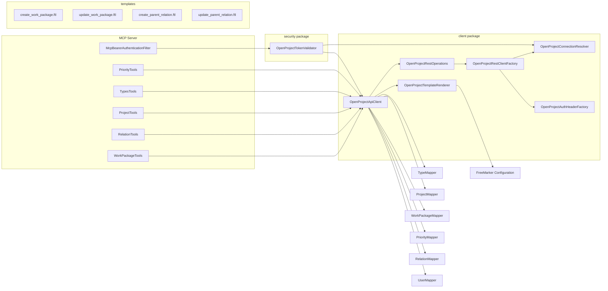

## Overview

The OpenProject REST Client subsystem provides a unified, Spring-managed bridge between the MCP server and the OpenProject REST API (v3). It spans seven collaborating components in the `de.tklein.tklab.openproject.mcp.openproject.client` package, plus a small set of Freemarker templates under `src/main/resources/templates/`.

At the top level, `OpenProjectApiClient` is the **public-facing service** (`@Service`) that tool classes (`WorkPackageTools`, `RelationTools`, `ProjectTools`, `TypesTools`, `PriorityTools`) call to create, read, update, and delete work packages and their metadata. The client delegates low-level HTTP transport to `OpenProjectRestOperations`, which in turn obtains a freshly-configured `RestClient` from `OpenProjectRestClientFactory` on every call. This design ensures that each HTTP request carries the **current** connection credentials, even in a multi-tenant scenario where different callers supply different bearer tokens.

## Connection Resolution

### OpenProjectConnection

A plain, immutable record (`repo://src/main/java/de/tklein/tklab/openproject/mcp/openproject/client/OpenProjectConnection.java`) holding two fields:

- `baseUrl` — the OpenProject instance URI (e.g. `https://openproject.example.com`)
- `bearerToken` — the raw API key / bearer token

No validation or transformation is performed at this layer; the record is a pure data carrier.

### OpenProjectConnectionResolver Interface

```java
public interface OpenProjectConnectionResolver {
  OpenProjectConnection resolve();
}
```

The interface is a single-method contract used by `OpenProjectRestClientFactory` and `OpenProjectTokenValidator` to obtain credentials at call time. Two concrete implementations exist:

| Implementation | Activation | Source of credentials |
|---|---|---|
| **HttpHeaderOpenProjectConnectionResolver** | `@Component` (active by default) | `X-OpenProject-Base-Url` request header (if `openproject.allow-header-base-url=true`) or `openproject.url` fallback config; `Authorization: Bearer <token>` request header |
| **EnvOpenProjectConnectionResolver** | `@Component` **disabled** (commented out) | `OPENPROJECT_BASE_URL` and `OPENPROJECT_BEARER_TOKEN` environment variables |

`HttpHeaderOpenProjectConnectionResolver` (`repo://src/main/java/de/tklein/tklab/openproject/mcp/openproject/client/HttpHeaderOpenProjectConnectionResolver.java#L1-L60`) also uses `ObjectProvider<HttpServletRequest>` to lazily access the current request, returning `null` when no request context is available (e.g. during startup). When the header-based URL override is disabled (the default), the resolver always falls back to the Spring `@Value("${openproject.url}")` property.

### Integration-Test Override

The integration test `OpenProjectApiClientIntegrationTest` (`repo://src/test/java/de/tklein/tklab/openproject/mcp/openproject/client/OpenProjectApiClientIntegrationTest.java#L95-L105`) provides a `@TestConfiguration` that registers a `@Primary` `OpenProjectConnectionResolver` bean returning a hardcoded `OpenProjectConnection` with the in-container OpenProject URL and a freshly generated admin API key. This ensures the test runs against the real OpenProject instance without depending on HTTP headers.

## RestClient Lifecycle and the Factory Pattern

`OpenProjectRestClientFactory` (`repo://src/main/java/de/tklein/tklab/openproject/mcp/openproject/client/OpenProjectRestClientFactory.java`) is the bridge between the connection-resolver pattern and Spring's `RestClient`:

1. It calls `connectionResolver.resolve()` to obtain the current `OpenProjectConnection`.
2. It delegates `bearerToken` to `OpenProjectAuthHeaderFactory` to produce the wire-format `Authorization` header.
3. It calls `restClientBuilder.clone()` to avoid mutating the shared `RestClient.Builder` bean, then sets `baseUrl` and the default `Authorization` header before building.

Every call to `OpenProjectRestOperations.op()` (`repo://src/main/java/de/tklein/tklab/openproject/mcp/openproject/client/OpenProjectRestOperations.java#L31-L33`) triggers a fresh `createClient()` invocation, meaning credentials are resolved **per-request**. This is the key mechanism that enables multi-tenant routing: each caller's token and base URL are picked up dynamically rather than at application startup.

### OpenProjectAuthHeaderFactory

`OpenProjectAuthHeaderFactory` (`repo://src/main/java/de/tklein/tklab/openproject/mcp/openproject/client/OpenProjectAuthHeaderFactory.java#L1-L18`) converts a bearer token into OpenProject's wire format:

```
Basic base64("apikey:" + bearerToken)
```

The factory validates that the token is non-blank, throwing `IllegalArgumentException` otherwise. The `"apikey:"` prefix is OpenProject's convention for API-key-based authentication; without it the server would treat the token as a password for a regular user account.

## Low-Level HTTP Operations

`OpenProjectRestOperations` (`repo://src/main/java/de/tklein/tklab/openproject/mcp/openproject/client/OpenProjectRestOperations.java`) exposes five HTTP methods, each delegating to the per-request `RestClient`:

| Method | HTTP verb | Content-Type | Accept | Return type |
|---|---|---|---|---|
| `getJson` | GET | — | `application/hal+json` | `JsonNode` |
| `postJson` | POST | `application/json` | `application/hal+json` | `JsonNode` |
| `patchJson` | PATCH | `application/json` | `application/hal+json` | `JsonNode` |
| `delete` | DELETE | — | `application/hal+json` | `void` (bodiless) |
| `postMultipart` | POST | `multipart/form-data` | `application/hal+json` | `JsonNode` |

All methods use Spring URI template expansion (`uri(String, Object...`) to substitute path variables. The `APPLICATION_HAL_JSON` constant is defined on the class itself (`repo://src/main/java/de/tklein/tklab/openproject/mcp/openproject/client/OpenProjectRestOperations.java#L27`).

### Multipart Attachment Support

`buildMultipartAttachmentBody` (`repo://src/main/java/de/tklein/tklab/openproject/mcp/openproject/client/OpenProjectRestOperations.java#L90-L112`) constructs a `MultiValueMap` with two parts for OpenProject's attachment API:

1. **metadata** — a JSON entity (`{"fileName": "..."}`) with `Content-Type: application/json`
2. **file** — a `ByteArrayResource` with the original file's content type (or `application/octet-stream` as fallback)

This is used by `OpenProjectApiClient.workPackageUploadAttachment`.

### Embedded-Element Mapping Helper

`mapEmbeddedElements` (`repo://src/main/java/de/tklein/tklab/openproject/mcp/openproject/client/OpenProjectRestOperations.java#L105-L112`) navigates the HAL+JSON envelope to extract `_embedded.elements[]` and maps each node through a caller-supplied `Function<JsonNode, T>`. It returns an empty list when the result is null, not an array, or missing. All list-returning client methods (`workPackageList`, `typeList`, `priorityList`, `projectList`) use this helper.

## Freemarker Template Rendering

`OpenProjectTemplateRenderer` (`repo://src/main/java/de/tklein/tklab/openproject/mcp/openproject/client/OpenProjectTemplateRenderer.java`) wraps FreeMarker's `Configuration` to render JSON payload templates into strings:

```java
public String render(String templateName, Map<String, ?> model)
```

The method catches `IOException` and `TemplateException` and wraps them in an `InternalError` with a descriptive message. Four templates are used in production:

| Template | Purpose |
|---|---|
| `create_work_package.ftl` | Full work-package creation payload with `_links` for type, priority, project, status, etc. |
| `update_work_package.ftl` | Partial update (PATCH) payload with conditional fields (`<#if ...??>`) and `lockVersion` |
| `create_parent_relation.ftl` | Relation creation payload with `type`, `description`, and `_links.to.href` |
| `update_parent_relation.ftl` | Parent-link update with `lockVersion` and conditional `parent.href` |

The templates use FreeMarker's `<#if ...??>` conditional syntax and `${...?json_string}` escaping to safely embed values into JSON. The `PatchMap` utility (`repo://src/main/java/de/tklein/tklab/openproject/mcp/util/PatchMap.java`) is used as the model builder, with `ALLOW_NULL_VALUES` to permit null entries to pass through (rather than being omitted).

## OpenProjectApiClient — High-Level Service

`OpenProjectApiClient` (`repo://src/main/java/de/tklein/tklab/openproject/mcp/openproject/client/OpenProjectApiClient.java`) is the central service class. It depends on:

- `OpenProjectRestOperations` — HTTP transport
- `OpenProjectTemplateRenderer` — payload rendering
- Six mappers (`WorkPackageMapper`, `ProjectMapper`, `TypeMapper`, `PriorityMapper`, `RelationMapper`, `UserMapper`) — JSON-to-DTO conversion

### Key Responsibilities and Entry Points

| Method | Behavior |
|---|---|
| `root()` | Calls `GET /api/v3`, maps the root response through `UserMapper.fromRoot()` to identify the authenticated user. |
| `workPackageList(projectId)` | `GET /api/v3/projects/{projectId}/work_packages?pageSize=1000`; extracts `_embedded.elements` via `mapEmbeddedElements`. |
| `workPackageShow(wpId)` | `GET /api/v3/work_packages/{wpId}`; returns `null` on 404 (not an exception). |
| `workPackageCreate(projectId, dto)` | Builds a `PatchMap` model, renders `create_work_package.ftl`, `POST`s to `/api/v3/projects/{projectId}/work_packages`; returns the created work package's `id`. |
| `workPackageUpdate(wpId, dto)` | Builds a `PatchMap` model, renders `update_work_package.ftl`, `PATCH`es `/api/v3/work_packages/{wpId}`; returns `true` on success. |
| `workPackageUploadAttachment(wpId, fileName, content, contentType)` | Builds multipart body via `buildMultipartAttachmentBody`, `POST`s to `/api/v3/work_packages/{wpId}/attachments`; returns attachment `id`. |
| `typeList(projectId)` | `GET /api/v3/projects/{projectId}/types` |
| `priorityList()` | `GET /api/v3/priorities` |
| `projectList()` | `GET /api/v3/projects` |
| `listRelationsForWorkPackage(wpId)` | Complex multi-source relation extraction (see below). |
| `relationAdd(wpId, otherWpId, description, type)` | Renders `create_parent_relation.ftl`, `POST`s to `/api/v3/work_packages/{wpId}/relations`; returns `true` if the response has `id` and `_type`. |
| `relationDelete(relationId)` | `DELETE /api/v3/relations/{relationId}`; returns `false` on any exception (logs warning). |
| `relationAddParent(wpId, parentId)` | Reads `lockVersion` from the work package, renders `update_parent_relation.ftl`, `PATCH`es the work package with a parent link. |
| `relationDeleteParent(wpId)` | Like `relationAddParent` but sets `parentHref` to `null`. |

### Relation Extraction Strategy

`listRelationsForWorkPackage` (`repo://src/main/java/de/tklein/tklab/openproject/mcp/openproject/client/OpenProjectApiClient.java#L142-L185`) aggregates relations from four distinct sources within a single work-package JSON response:

1. **Explicit relations** — `_embedded.relations._embedded.elements[]` (the HAL+JSON nested resource array). Mapped via `RelationMapper.fromRelationElement()`.
2. **Parent link** — `_links.parent` (derived from HAL links). Mapped via `RelationMapper.fromWpLink("parent", ...)`.
3. **Children links** — `_links.children[]` array. Each element mapped as a "children" relation.
4. **Ancestors links** — `_links.ancestors[]` array. Each element mapped as an "ancestors" relation.

Results are filtered to exclude entries where `toId`, `to`, and `id` are all null. This four-source approach is necessary because the OpenProject HAL+JSON response embeds explicit relations in `_embedded` but encodes parent/children/ancestors as `_links` entries rather than embedded resources.

### Failure Semantics

| Scenario | Behavior |
|---|---|
| 404 on `workPackageShow` | Returns `null` (not an exception). |
| 404 on `workPackageList` / non-existent project | Propagates `RestClientResponseException` (404). |
| 422 on `relationAdd` with invalid IDs | Propagates `HttpClientErrorException` (422). |
| `relationDelete` on non-existent relation | Returns `false` (logs warning); does not propagate. |
| Freemarker template failure | Throws `InternalError` wrapping the original `IOException`/`TemplateException`. |

## Security Integration

`OpenProjectTokenValidator` (`repo://src/main/java/de/tklein/tklab/openproject/mcp/openproject/security/OpenProjectTokenValidator.java`) depends on both `OpenProjectConnectionResolver` and `OpenProjectApiClient`. Its `validateCurrentRequestOrThrow()` method:

1. Resolves the current connection via `connectionResolver.resolve()`.
2. Validates that `baseUrl` and `bearerToken` are non-blank.
3. Hashes `baseUrl + "|" + token` with SHA-256 to produce a cache key (the raw token is never stored).
4. Calls the `cachedCheckToken` supplier, which invokes `openProjectApiClient.root()` to verify the token against the OpenProject server.
5. Caches the result (`ValidatedOpenProjectUser`) keyed by the hashed token.

`McpBearerAuthenticationFilter` (`repo://src/main/java/de/tklein/tklab/openproject/mcp/openproject/security/McpBearerAuthenticationFilter.java`) is a Spring `OncePerRequestFilter` that:

- Filters only MCP endpoints (`/sse`, `/mcp`, `/mcp/*`).
- Calls `tokenValidator.validateCurrentRequestOrThrow()` on every request.
- Sets a `UsernamePasswordAuthenticationToken` with `ROLE_MCP_USER` into `SecurityContextHolder`.
- Persists the security context to a `RequestAttributeSecurityContextRepository` so it survives async dispatch (required for SSE).
- On `UnauthorizedException`, clears the context and returns HTTP 401 with `{"error":"unauthorized"}`.

`fetchUserFromOpenProject()` in `OpenProjectTokenValidator` is a template method that `OpenProjectApiClient.root()` calls. Tests can override it to avoid real network calls while preserving caching behavior.

## Architecture Diagram



## Configuration

| Property | Default | Purpose |
|---|---|---|
| `openproject.url` | *(required)* | Fallback base URL for the OpenProject instance |
| `openproject.allow-header-base-url` | `false` | When `true`, allows `X-OpenProject-Base-Url` header to override the configured URL per-request |

The `HttpHeaderOpenProjectConnectionResolver` reads these via `@Value` injection. The `OPENPROJECT_BASE_URL` and `OPENPROJECT_BEARER_TOKEN` environment variables are read by the disabled `EnvOpenProjectConnectionResolver`.

## Extension Points

- **New connection resolvers**: Implement `OpenProjectConnectionResolver` and register as a `@Component`. If multiple beans exist, mark one `@Primary` or use `ObjectProvider` injection to disambiguate.
- **Template rendering**: The `OpenProjectTemplateRenderer` is injected with a Spring `Configuration` bean. New templates can be added to `src/main/resources/templates/` without code changes if they follow the existing `PatchMap` model contract.
- **Token validation**: `OpenProjectTokenValidator.fetchUserFromOpenProject()` is a template method; subclasses can override it to use a different validation mechanism (e.g., introspection endpoint).
- **REST operations**: `OpenProjectRestOperations` could be extended with additional HTTP methods (e.g., PUT, HEAD) or content types as needed.

## Testing

The integration test `OpenProjectApiClientIntegrationTest` (`repo://src/test/java/de/tklein/tklab/openproject/mcp/openproject/client/OpenProjectApiClientIntegrationTest.java`) covers:

- Container lifecycle (docker compose up/down with configurable tag, port, shutdown)
- `root()` authentication
- `projectList()` with demo project detection
- `workPackageShow` returning `null` for non-existent IDs
- `relationDelete` returning `false` for non-existent relations
- `workPackageList` throwing 404 for non-existent projects
- `priorityList` and `typeList` returning non-empty lists with IDs and names
- Full CRUD cycle: create work package, list, show, update subject, upload attachment, add/delete relation, add/delete parent relation

The test configures a `@Primary` `OpenProjectConnectionResolver` bean that returns hardcoded credentials, and it starts a real OpenProject container to validate against the actual API.
