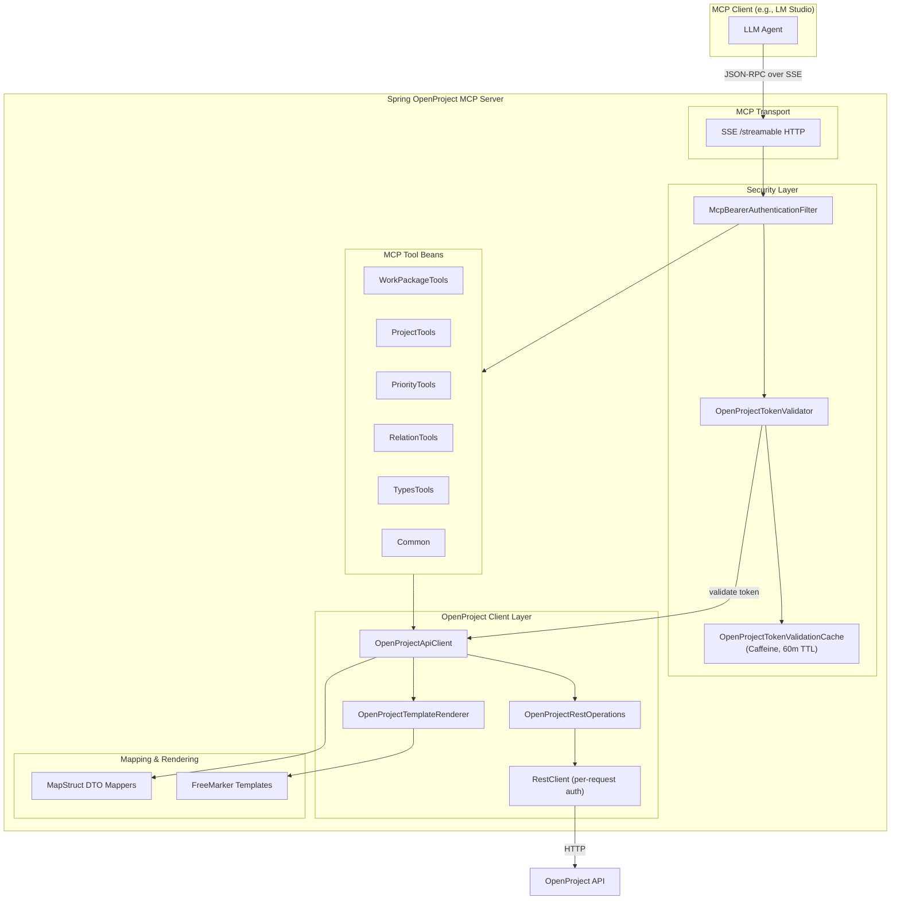
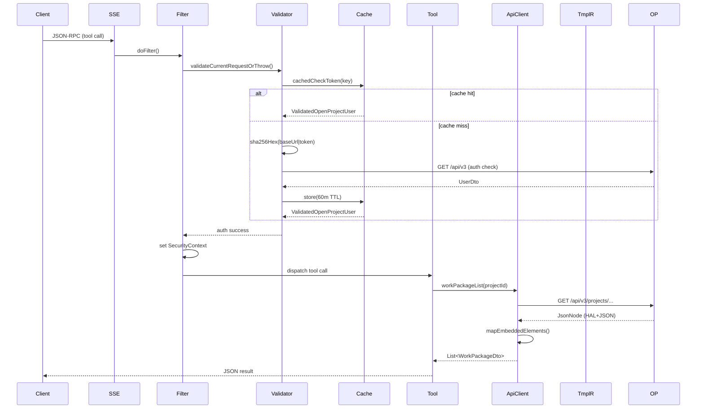

# System Overview

The Spring OpenProject MCP Server is a Java 25 application built on Spring Boot 4.1.1 with Spring AI 2.0.1 that exposes an [MCP](https://modelcontextprotocol.io/) (Model Context Protocol) server for managing OpenProject work packages. It acts as a thin proxy between an MCP-compatible client (e.g., an LLM agent) and the OpenProject REST API (`/api/v3`), translating MCP tool calls into authenticated HTTP requests and returning structured results as JSON.

## Architecture Diagram

*Figure 1: High-level component architecture and request flow.*

## Core Components

### Entry Point

The application is a standard Spring Boot 4.1.1 application with `SpringOpenprojectMcpServerApplication` as its `@SpringBootApplication` entry point (`repo://src/main/java/de/tklein/tklab/openproject/mcp/SpringOpenprojectMcpServerApplication.java`). It runs on port `8080` with a separate management port at `8081`.

### MCP Transport

The server uses Spring AI's MCP server starter (`spring-ai-starter-mcp-server`) with the `webmvc` transport (`spring-ai-starter-mcp-server-webmvc`). The protocol is configurable via `spring.ai.mcp.server.protocol`:

- **SSE** (`spring.ai.mcp.server.protocol=sse`): Exposes `GET /sse` for server-to-client streaming and `POST /mcp` for client-to-server JSON-RPC messages.
- **STREAMABLE**: Exposes a single bidirectional endpoint at `/mcp` based on the MCP streamable HTTP spec.

The two protocols cannot be bound simultaneously because the transport defines the wiring, endpoints, and message routing. The default is SSE.

Configuration is in `repo://src/main/resources/application.properties`:
- `spring.ai.mcp.server.name=openproject-mcp-server`
- `spring.ai.mcp.server.version=1.2.0`
- `spring.ai.mcp.server.type=sync`
- `spring.ai.mcp.server.capabilities.tool=true`
- `spring.ai.mcp.server.annotation-scanner.enabled=true`

### Security Model

Authentication uses a two-layer approach:

1. **MCP-level authentication**: The `McpBearerAuthenticationFilter` (`repo://src/main/java/de/tklein/tklab/openproject/mcp/security/McpBearerAuthenticationFilter.java`) intercepts requests to `/mcp` and `/sse` paths, extracts the `Authorization: Bearer <token>` header, and validates the token against OpenProject.

2. **OpenProject API authentication**: The validated bearer token is converted to OpenProject's expected `Basic` auth format (`apikey:<token>`) by `OpenProjectAuthHeaderFactory` (`repo://src/main/java/de/tklein/tklab/openproject/mcp/openproject/client/OpenProjectAuthHeaderFactory.java`), which then serves as the `Authorization` header for all outbound HTTP requests to the OpenProject REST API.

Token validation uses `OpenProjectTokenValidator` (`repo://src/main/java/de/tklein/tklab/openproject/mcp/security/OpenProjectTokenValidator.java`), which calls `OpenProjectApiClient.root()` (the `/api/v3` endpoint) to verify the token. Validated user info (`href`, `name`) is cached in a Caffeine-backed `@Cacheable` store (`repo://src/main/java/de/tklein/tklab/openproject/mcp/security/OpenProjectTokenValidationCache.java`) with a 60-minute TTL. The raw token is never stored in the cache; only its SHA-256 hash serves as the cache key.

The `OpenProjectConnectionResolver` interface (`repo://src/main/java/de/tklein/tklab/openproject/mcp/openproject/client/OpenProjectConnectionResolver.java`) abstracts how the OpenProject base URL and bearer token are obtained. The active implementation is `HttpHeaderOpenProjectConnectionResolver` (`repo://src/main/java/de/tklein/tklab/openproject/mcp/openproject/client/HttpHeaderOpenProjectConnectionResolver.java`), which reads the base URL from:
- The configured `openproject.url` property (default `https://localhost`), or
- The `X-OpenProject-Base-Url` header when `openproject.allow-header-base-url=true` is set.

A secondary `EnvOpenProjectConnectionResolver` (`repo://src/main/java/de/tklein/tklab/openproject/mcp/openproject/client/EnvOpenProjectConnectionResolver.java`) exists but is commented out, providing an environment-variable-based alternative (`OPENPROJECT_BASE_URL`, `OPENPROJECT_BEARER_TOKEN`).

Spring Security configures two filter chains in `SecurityConfig` (`repo://src/main/java/de/tklein/tklab/openproject/mcp/security/SecurityConfig.java`):
- **Actuator chain** (`@Order(1)`): Protects `/actuator/**` with HTTP Basic auth for an admin user. Health endpoints are publicly accessible.
- **MCP chain** (`@Order(2)`): Protects `/mcp/**`, `/mcp`, `/error`, and `/sse` with bearer-based authentication via the custom filter. CSRF is disabled.

The `McpBearerAuthenticationFilter` is explicitly registered inside the Spring Security chain (not as a global servlet filter) via a `FilterRegistrationBean` with `setEnabled(false)`.

### MCP Tools

The server exposes five tool beans and one logging handler, each annotated with `@McpTool`, `@McpPrompt`, or `@McpLogging`:

| Component | Purpose |
|---|---|
| `WorkPackageTools` (`repo://src/main/java/de/tklein/tklab/openproject/mcp/tools/WorkPackageTools.java`) | Query, create, update work packages; upload attachments; provides a `safe_edit` prompt for diff-based safe editing with lockVersion concurrency control. |
| `ProjectTools` (`repo://src/main/java/de/tklein/tklab/openproject/mcp/tools/ProjectTools.java`) | List visible projects; provides a `project.summary` prompt generator. |
| `PriorityTools` (`repo://src/main/java/de/tklein/tklab/openproject/mcp/tools/PriorityTools.java`) | List available priorities. |
| `RelationTools` (`repo://src/main/java/de/tklein/tklab/openproject/mcp/tools/RelationTools.java`) | List/add/delete work package relations (relates, blocks, precedes, duplicates, includes, requires); manage parent/child hierarchy. |
| `TypesTools` (`repo://src/main/java/de/tklein/tklab/openproject/mcp/tools/TypesTools.java`) | List allowed work package types for a project. |
| `Common` (`repo://src/main/java/de/tklein/tklab/openproject/mcp/tools/Common.java`) | Handles MCP `logging/message` notifications, forwarding them to application log. |

All tools are `@Component` beans with constructor injection of `OpenProjectApiClient`. The `@Validated` annotation on tools enables Jakarta Bean Validation for tool parameters.

### OpenProject Client Layer

`OpenProjectApiClient` (`repo://src/main/java/de/tklein/tklab/openproject/mcp/openproject/client/OpenProjectApiClient.java`) is the central service that translates MCP tool operations into OpenProject REST API calls. It:

- Delegates HTTP requests to `OpenProjectRestOperations` (`repo://src/main/java/de/tklein/tklab/openproject/mcp/openproject/client/OpenProjectRestOperations.java`), which creates a per-request `RestClient` via `OpenProjectRestClientFactory` (`repo://src/main/java/de/tklein/tklab/openproject/mcp/openproject/client/OpenProjectRestClientFactory.java`). Each request gets a fresh client with the current connection's base URL and auth header.
- Uses `application/hal+json` as the content type for all API communication.
- Supports GET, POST, PATCH, DELETE, and multipart POST operations.

For write operations (create work package, update work package, add parent relation), the client delegates to `OpenProjectTemplateRenderer` (`repo://src/main/java/de/tklein/tklab/openproject/mcp/openproject/client/OpenProjectTemplateRenderer.java`), which uses FreeMarker to render JSON request bodies from templates in `repo://src/main/resources/templates/`. This approach avoids the brittleness of a generated OpenAPI client while maintaining compatibility across OpenProject 14, 15, 16.6, and 17.7. The templates are:
- `create_work_package.ftl`
- `update_work_package.ftl`
- `create_parent_relation.ftl`
- `update_parent_relation.ftl`

The `PatchMap` utility (`repo://src/main/java/de/tklein/tklab/openproject/mcp/util/PatchMap.java`) provides a fluent API for building maps with optional null-value filtering, used to populate template models with only the fields that have non-null values.

### DTOs and Mappers

The system defines domain-specific DTOs (`repo://src/main/java/de/tklein/tklab/openproject/mcp/dto/`) for all OpenProject entities:

- `WorkPackageDto` — work package fields (id, subject, description, dates, story points, type, priority, etc.)
- `WorkPackageCreateDto` — validation groups (`OnCreate`) for required fields on creation
- `WorkPackageUpdateDto` — extends `WorkPackageCreateDto` with `lockVersion` for optimistic locking
- `ProjectDto` — project metadata
- `PriorityDto`, `TypeDto`, `RelationDto`, `RelationValuesDto`, `UserDto`

MapStruct mappers (`repo://src/main/java/de/tklein/tklab/openproject/mcp/mapper/`) convert between `JsonNode` (raw API responses) and DTOs. They use default methods for custom mapping logic (e.g., extracting nested paths, parsing date strings, handling missing nodes). The mappers are registered as Spring beans via `@Mapper(componentModel = "spring")`.

### Request Flow

*Figure 2: Request lifecycle from MCP client through auth to OpenProject API.*

### Configuration

Key configuration properties in `repo://src/main/resources/application.properties`:

| Property | Default | Purpose |
|---|---|---|
| `spring.ai.mcp.server.protocol` | `sse` | Transport protocol (sse or streamable) |
| `openproject.url` | `https://localhost` | Default OpenProject base URL |
| `openproject.allow-header-base-url` | `false` | Allow per-request URL override via `X-OpenProject-Base-Url` header |
| `spring.cache.type` | `caffeine` | Cache provider |
| `spring.cache.caffeine.spec` | `expireAfterWrite=60m,recordStats` | Auth validation cache spec |
| `management.server.port` | `8081` | Actuator management port |

Environment variable `OPENPROJECT_ALLOW_HEADER_BASE_URL=true` enables the header-based URL override at the container level.

### Extension Points

1. **Connection resolver**: Replace `HttpHeaderOpenProjectConnectionResolver` with a custom `OpenProjectConnectionResolver` implementation (e.g., `EnvOpenProjectConnectionResolver` or a new one) to change how the OpenProject URL and bearer token are resolved.

2. **Token validator**: Override `fetchUserFromOpenProject()` in `OpenProjectTokenValidator` (as done in tests) to customize token validation logic without affecting caching or keying behavior.

3. **MCP tools**: Add new `@McpTool`-annotated `@Component` beans to expose additional MCP tools. The annotation scanner auto-discovers them.

4. **FreeMarker templates**: Extend or modify the four `.ftl` templates to change the JSON structure sent to the OpenProject API.

5. **MapStruct mappers**: Add new `@Mapper` interfaces for new DTO types.

### Testing

Tests are in `repo://src/test/java/de/tklein/tklab/openproject/mcp/`:

- **Integration tests** (`@Tag(TAG_INTEGRATION_TEST_LOCAL)`): Run against a real OpenProject Docker container (`mvn test -Dopenproject.container.tag=17.5.1`). Includes `OpenProjectApiClientIntegrationTest`.
- **MCP protocol tests**: `McpToolsListIntegrationTest`, `McpPromptsIntegrationTest`, `McpPingIntegrationTest` verify MCP tool discovery, prompt generation, and ping responses via raw HTTP against a random-port server.
- **Security tests**: `McpSecurityIntegrationTest` parameterizes auth scenarios (valid/invalid/missing tokens) across `initialize`, tools/list, and ping endpoints.
- **Unit tests**: `WorkPackageToolsTest`, `ProjectToolsTest`, `RelationToolsTest`, `PriorityToolsTest`, `TypesToolsTest`, `PatchMapTest` test individual components.
- `McpToolsHelper` provides shared HTTP client code for MCP protocol testing.

### Operational Notes

- The Docker image runs on port `8080`; the `--tmpfs /tmp` mount prevents temp file leakage between container restarts.
- The API token is passed per-MCP-request via the `Authorization` header and never persisted in the container.
- Actuator admin credentials are configured via `actuator.security.admin.username` and `actuator.security.admin.password-hash` (bcrypt-prefixed).
- OTel tracing, logging, and metrics are all disabled by default.
- The `spring-openproject-mcp-server` is licensed under MIT and tested against OpenProject versions 14, 15, 16.6, and 17.7.
