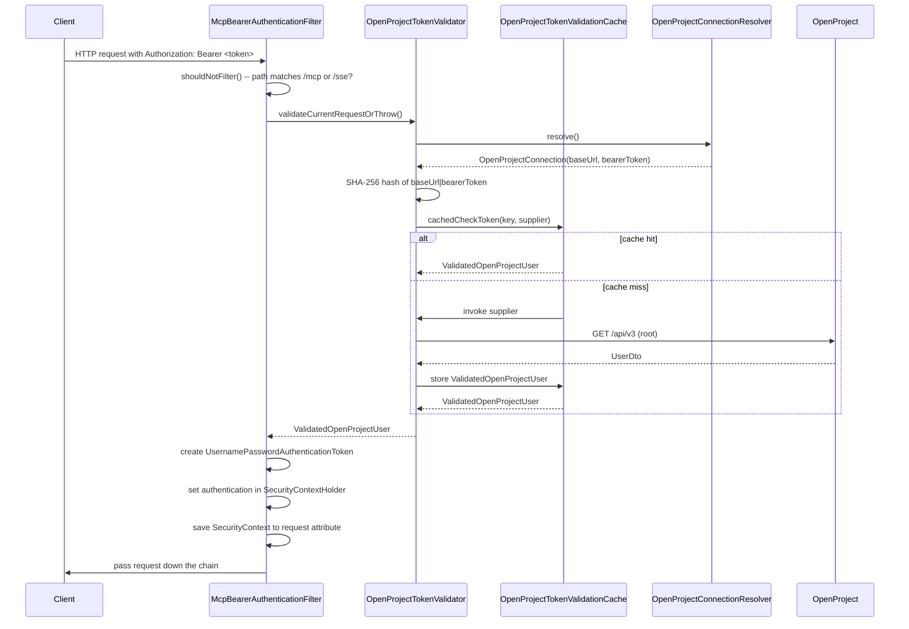

# Security Architecture

This page documents the authentication and authorization layer of the OpenProject MCP server. The system validates incoming MCP requests against an external OpenProject instance using bearer tokens, caches validation results with Caffeine, and supports multi-tenant scenarios where each request can target a different OpenProject deployment.

## Spring Security Filter Chains

`SecurityConfig` ([repo://src/main/java/de/tklein/tklab/openproject/mcp/security/SecurityConfig.java](repo://src/main/java/de/tklein/tklab/openproject/mcp/security/SecurityConfig.java)) defines two `SecurityFilterChain` beans, distinguished by `@Order` and `securityMatcher` path predicates.

### Actuator Chain (Order 1)

- **Path predicate:** `/actuator/**`
- **Auth mechanism:** HTTP Basic authentication
- **Authorization:** Only `/actuator/health` and `/actuator/health/*` are permitted without credentials. All other actuator endpoints require the `ACTUATOR_ADMIN` role.
- **CSRF:** Disabled
- **User store:** `InMemoryUserDetailsManager` configured from `actuator.security.admin.username` and `actuator.security.admin.password-hash` properties. The password hash must include an `{id}` prefix (e.g. `{bcrypt}...`).

The actuator chain is evaluated first because of `@Order(1)`. It provides health-check access and protects all other Spring Boot Actuator endpoints with basic auth.

### MCP Chain (Order 2)

- **Path predicate:** `/mcp/**`, `/mcp`, `/error`, `/sse`
- **Auth mechanism:** Bearer token (no HTTP Basic)
- **Authorization:** All requests require authentication (`anyRequest().authenticated()`)
- **CSRF:** Disabled
- **HTTP Basic:** Explicitly disabled

The MCP filter (`McpBearerAuthenticationFilter`, a `@Component`) is **not** registered as a global servlet filter. `SecurityConfig` creates a `FilterRegistrationBean<McpBearerAuthenticationFilter>` with `setEnabled(false)` to suppress the automatic registration. Instead, the filter is injected explicitly into the MCP chain via `addFilterBefore(mcpFilter, UsernamePasswordAuthenticationFilter.class)`, so it runs inside the Spring Security filter pipeline.

## Bearer Token Validation Flow

The validation of each incoming MCP request follows a well-defined pipeline:



### Step 1: Connection Resolution

`OpenProjectConnectionResolver` ([repo://src/main/java/de/tklein/tklab/openproject/mcp/openproject/client/OpenProjectConnectionResolver.java](repo://src/main/java/de/tklein/tklab/openproject/mcp/openproject/client/OpenProjectConnectionResolver.java)) is the interface that abstracts where OpenProject connection details come from. Two implementations exist:

1. **`HttpHeaderOpenProjectConnectionResolver`** -- The active, production resolver. It reads the `Authorization` header from the current `HttpServletRequest` (via `ObjectProvider<HttpServletRequest>`) to extract the bearer token, and optionally reads `X-OpenProject-Base-Url` for multi-tenant URL override.

2. **`EnvOpenProjectConnectionResolver`** -- A commented-out (`// @Component`) resolver that reads `OPENPROJECT_BASE_URL` and `OPENPROJECT_BEARER_TOKEN` from environment variables. It is intended for a future STDIO-based deployment mode.

### Step 2: Token Keying and Caching

`OpenProjectTokenValidator` ([repo://src/main/java/de/tklein/tklab/openproject/mcp/security/OpenProjectTokenValidator.java](repo://src/main/java/de/tklein/tklab/openproject/mcp/security/OpenProjectTokenValidator.java)) constructs a cache key by concatenating `baseUrl|bearerToken` and computing a SHA-256 hex digest (`DigestUtils.sha256Hex`). The raw token is **never** stored in the cache.

The cache lookup uses Spring's `@Cacheable` annotation on `OpenProjectTokenValidationCache.cachedCheckToken()` ([repo://src/main/java/de/tklein/tklab/openproject/mcp/security/OpenProjectTokenValidationCache.java](repo://src/main/java/de/tklein/tklab/openproject/mcp/security/OpenProjectTokenValidationCache.java)). The cache name is `auth-validation`, configured in `application.properties` ([repo://src/main/resources/application.properties](repo://src/main/resources/application.properties)) as:

```properties
spring.cache.type=caffeine
spring.cache.cache-names=auth-validation
spring.cache.caffeine.spec=expireAfterWrite=60m,recordStats
```

On a cache miss, the method invokes a `Supplier<ValidatedOpenProjectUser>` that calls `fetchUserFromOpenProject()` (a template method) to perform the actual API call. The result is stored in the Caffeine cache with a 60-minute write expiry and stats recording enabled.

### Step 3: OpenProject API Validation

The token validation call goes through `OpenProjectApiClient.root()` ([repo://src/main/java/de/tklein/tklab/openproject/mcp/openproject/client/OpenProjectApiClient.java](repo://src/main/java/de/tklein/tklab/openproject/mcp/openproject/client/OpenProjectApiClient.java)), which performs `GET /api/v3`. The HTTP client is built by `OpenProjectRestClientFactory` ([repo://src/main/java/de/tklein/tklab/openproject/mcp/openproject/client/OpenProjectRestClientFactory.java](repo://src/main/java/de/tklein/tklab/openproject/mcp/openproject/client/OpenProjectRestClientFactory.java)), which uses `OpenProjectAuthHeaderFactory` ([repo://src/main/java/de/tklein/tklab/openproject/mcp/openproject/client/OpenProjectAuthHeaderFactory.java](repo://src/main/java/de/tklein/tklab/openproject/mcp/openproject/client/OpenProjectAuthHeaderFactory.java)) to convert the bearer token into OpenProject's expected `Basic` auth header format (`Basic base64("apikey:<token>")`).

The `root()` call returns a `UserDto`. If the response is `null`, the `href` is `null` or blank, or any `RestClientResponseException` occurs, `UnauthorizedException` is thrown.

### Step 4: Security Context Establishment

`McpBearerAuthenticationFilter` ([repo://src/main/java/de/tklein/tklab/openproject/mcp/security/McpBearerAuthenticationFilter.java](repo://src/main/java/de/tklein/tklab/openproject/mcp/security/McpBearerAuthenticationFilter.java)) wraps the validated user in a `UsernamePasswordAuthenticationToken` with a single `ROLE_MCP_USER` authority, sets it on `SecurityContextHolder`, and persists the context to a request attribute via `RequestAttributeSecurityContextRepository`. This attribute-based persistence is critical for Spring Security to restore the context during the async dispatches used by the SSE protocol.

If validation fails, the filter clears `SecurityContextHolder`, sets HTTP 401 status, and writes `{"error":"unauthorized"}` as `application/json`.

## Multi-Tenant Connection Resolution

`HttpHeaderOpenProjectConnectionResolver` ([repo://src/main/java/de/tklein/tklab/openproject/mcp/openproject/client/HttpHeaderOpenProjectConnectionResolver.java](repo://src/main/java/de/tklein/tklab/openproject/mcp/openproject/client/HttpHeaderOpenProjectConnectionResolver.java)) enables each MCP request to target a different OpenProject instance:

- **Base URL:** Read from `X-OpenProject-Base-Url` header when `openproject.allow-header-base-url=true`. Falls back to the `openproject.url` property.
- **Bearer token:** Extracted from the `Authorization` header (prefix `Bearer ` stripped).
- **Configuration:** `openproject.allow-header-base-url` defaults to `false` in `application.properties`.

The resolver always returns an `OpenProjectConnection` record ([repo://src/main/java/de/tklein/tklab/openproject/mcp/openproject/client/OpenProjectConnection.java](repo://src/main/java/de/tklein/tklab/openproject/mcp/openproject/client/OpenProjectConnection.java)) containing the `baseUrl` URI and `bearerToken` string.

## Token Cache Invalidation

The Caffeine cache uses `expireAfterWrite=60m` with no explicit eviction policy beyond TTL. Tokens are never removed from the cache by invalidation logic -- a token that was valid at validation time remains cached for 60 minutes even if the user is later disabled or the token is revoked in OpenProject. This is a design trade-off favoring latency over strict real-time revocation.

## Security Context Repository

The filter uses `RequestAttributeSecurityContextRepository` (the default for servlet-based Spring Security) to persist the `SecurityContext`. This is essential because the MCP SSE protocol uses async dispatches: the original HTTP request completes after the SSE connection is established, and subsequent messages arrive as separate async dispatches. Without the attribute-based persistence, the context would be lost between dispatches.

The filter overrides `shouldNotFilterAsyncDispatch()` to return `false`, ensuring it runs on every async dispatch and re-validates the security context.

## Error Handling

`UnauthorizedException` ([repo://src/main/java/de/tklein/tklab/openproject/mcp/security/UnauthorizedException.java](repo://src/main/java/de/tklein/tklab/openproject/mcp/security/UnauthorizedException.java)) is an unchecked `RuntimeException` used throughout the validation pipeline. The filter catches it in `doFilterInternal` and translates it to an HTTP 401 response with a JSON body. Any other exception during validation propagates up the filter chain and results in a 500 error.

## Configuration Properties

| Property | Default | Purpose |
|---|---|---|
| `openproject.url` | `https://localhost` | Fallback base URL for OpenProject API |
| `openproject.allow-header-base-url` | `false` | Enable per-request URL override via header |
| `actuator.security.admin.username` | `admin` | Actuator admin username |
| `actuator.security.admin.password-hash` | (required) | bcrypt-prefixed password hash for actuator admin |

## Tests

`McpSecurityIntegrationTest` ([repo://src/test/java/de/tklein/tklab/openproject/mcp/tools/McpSecurityIntegrationTest.java](repo://src/test/java/de/tklein/tklab/openproject/mcp/tools/McpSecurityIntegrationTest.java)) validates the authentication flow end-to-end using a `@SpringBootTest` with a random port. It provides a stub `OpenProjectTokenValidator` via a `@TestConfiguration` that accepts a `VALID_TOKEN` ("correctToken") and rejects all others. The test covers:

- `initializeMcp` (MCP initialization) with valid/invalid/missing tokens
- `callToolsListRequest` with and without prior initialization
- `callPingRequest` with and without prior initialization
- `callPromptsListRequest` with and without prior initialization

Each scenario is parameterized with `@CsvSource` asserting the expected HTTP status code (200 for valid, 401 for invalid/missing, 404 for missing session).

## `ValidatedOpenProjectUser`

`ValidatedOpenProjectUser` ([repo://src/main/java/de/tklein/tklab/openproject/mcp/security/ValidatedOpenProjectUser.java](repo://src/main/java/de/tklein/tklab/openproject/mcp/security/ValidatedOpenProjectUser.java)) is a simple record holding the user's `href` (from the OpenProject user link) and `name`. It is the cache entry type and is stored as the principal in the `UsernamePasswordAuthenticationToken`. Its minimal structure means the cache stores only lightweight data -- the full `UserDto` is not retained.
