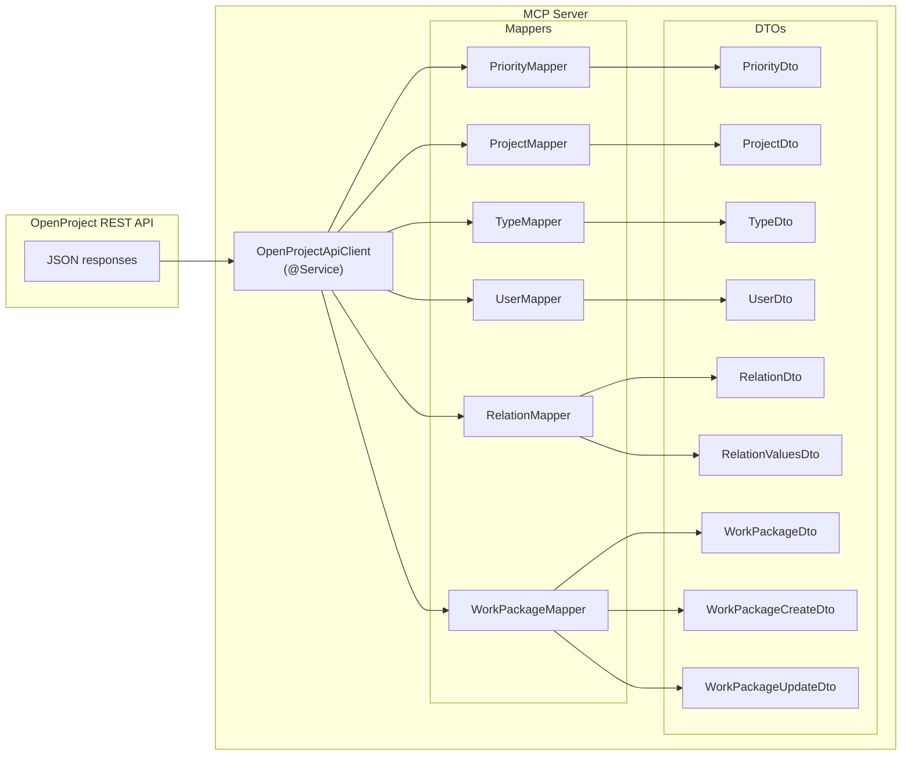

# DTOs and Mappers

This page describes the data transfer object (DTO) types and their corresponding
`JsonNode` → DTO mapper interfaces that bridge the OpenProject REST API's JSON
wire format to typed Java objects inside the MCP server.

## Architecture

All DTOs live in the `de.tklein.tklab.openproject.mcp.dto` package. All mappers
live in `de.tklein.tklab.openproject.mcp.mapper`. The sole consumer of every
mapper is the `OpenProjectApiClient` service (`OpenProjectApiClient`), which
receives all mappers via constructor injection and applies them to JSON responses
returned by the OpenProject REST API.

## DTOs

### PriorityDto

Represents a single priority from the OpenProject API (`/api/v3/priorities/{id}`).
Fields: `id`, `name`, `position`, `href`. `position` may be `null` when the API
omits it.

### ProjectDto

Represents a project from the OpenProject API. Fields: `id`, `identifier`,
`name`, `active`, `isPublic`, `status`, `description`, `createdAt`,
`updatedAt`, `href`. `isPublic` is mapped from the API field `public`.
`status` is read from `statusExplanation.raw`. Timestamps are ISO-8601 strings
parsed into `OffsetDateTime`.

### TypeDto

Represents a work package type. Fields: `id`, `name`, `defaultType` (from API
field `isDefault`), `milestone` (from API field `isMilestone`), `createdAt`,
`updatedAt`, `href`.

### UserDto

Represents the authenticated user extracted from the API root response
(`/api/v3`). Fields: `href` and `name` (from `_links.user.href` and
`_links.user.title`). Only populated via `UserMapper.fromRoot`.

### RelationDto

Represents a relation between work packages. Fields: `id` (always `null` for
derived relation types `parent`, `children`, `ancestors`), `type`, `description`,
`toId`, `to`.

### RelationValuesDto

A Java record (`String[] allowedToValues`) holding the allowed relation type
values (`relates`, `blocks`, `precedes`, `duplicates`, `includes`, `requires`).
Populated by `RelationTools.relationAllowedValues()` from the `RelationType`
enum.

### WorkPackageDto

Represents a work package. Fields: `id`, `lockVersion`, `subject`, `description`,
`storyPoints`, `startDate`, `dueDate`, `estimatedTime`, `duration`, `createdAt`,
`updatedAt`, `type`, `priority`, `href`. The `type` and `priority` name
properties are populated from either `_embedded` (single-work-package responses)
or `_links` (list responses) depending on context. `description` is read from
`description.raw` to obtain the rendered Markdown text.

### WorkPackageCreateDto

Input DTO for work package creation. Fields: `subject` (`@NotBlank` in
validation group `OnCreate`), `description`, `typeId` (`@NotNull` in group
`OnCreate`), `priorityId`, `startDate`, `dueDate`, `estimatedTime`,
`storyPoints` (`@Positive`).

### WorkPackageUpdateDto

Extends `WorkPackageCreateDto` and adds: `lockVersion` (`@NotNull`), and
overrides `subject` and `typeId` to remove the `@NotBlank`/`@NotNull`
constraints inherited from the superclass, making these fields optional for
partial updates.

### Common DTO conventions

All DTOs (except `RelationValuesDto`) are Lombok-powered classes annotated with
`@Getter`, `@Setter`, `@With`, `@NoArgsConstructor`, and `@AllArgsConstructor`.
They use `@JsonInclude(JsonInclude.Include.NON_NULL)` so that null-valued
properties are omitted during serialization. Jackson `@JsonProperty` annotations
with `@JsonPropertyDescription` Javadoc are applied to each field for API
documentation.

## Mappers

All mappers are MapStruct `@Mapper` interfaces. Each defines a single `default`
method that accepts a `tools.jackson.databind.JsonNode` and returns the
corresponding DTO. None of the mappers rely on MapStruct-generated implementations;
the `default` methods perform manual field extraction.

### PriorityMapper

Maps `id`, `name`, `position` (nullable when the node is missing), and `href`
from `_links.self.href`.

### ProjectMapper

Maps `id`, `identifier`, `name`, `active`, `isPublic` (from API field
`public`), `status` (from `statusExplanation.raw`), `description` (from
`description.raw`), `createdAt`/`updatedAt` (parsed via `OffsetDateTime.parse`),
and `href`.

### TypeMapper

Maps `id`, `name`, `defaultType` (from `isDefault`), `milestone` (from
`isMilestone`), `createdAt`/`updatedAt` (parsed), and `href`.

### UserMapper

Maps from the API root response (`/api/v3`). Extracts `_links.user.href` →
`href` and `_links.user.title` → `name`. Uses `StringUtils.trimToNull` to
normalize empty strings.

### RelationMapper

Provides three methods:

- `fromRelationElement(JsonNode)` — maps a single relation element from
  `_embedded.relations._embedded.elements[]`, extracting `id`, `type`,
  `description`, and `toId`/`to` from `_links.to`.
- `fromWpLink(String, JsonNode)` — maps a derived relation link (`parent`,
  `children`, or `ancestors`) from `_links.<type>`, setting `id` to `null`.
- `extractWpId(String)` — strips the `WP_PREFIX` (`/api/v3/work_packages/`)
  from an href string and parses the remainder as an integer. Returns `null` on
  parse failure.

### WorkPackageMapper

Maps `id`, `lockVersion`, `subject`, `description` (from `description.raw`),
`storyPoints` (null-safe check), `startDate`/`dueDate` (parsed via
`LocalDate.parse`), `estimatedTime`, `duration`, `createdAt`/`updatedAt` (parsed
via `OffsetDateTime.parse`), and `href`. The `type` and `priority` name fields
use a two-source strategy: first checks `_embedded.type` / `_embedded.priority`
for embedded data (single-work-package responses), then falls back to
`_links.type.title` / `_links.priority.title` for list responses.

## Null-safety and defensive handling

All mappers defensively handle null, missing, or empty JSON nodes:

- `node.path("field").asString(null)` returns `null` when the field is missing
  or not a string.
- `node.path("field").isMissingNode()` checks are used before calling `asInt()`
  on fields that may be absent (e.g., `position` in `PriorityMapper`).
- `node.get("field")` with explicit null-checks is used for fields where the
  absence of the node itself is significant (e.g., `storyPoints` in
  `WorkPackageMapper`).
- Timestamp parsing is guarded: `asString(null)` is checked for non-null before
  calling `OffsetDateTime.parse` or `LocalDate.parse`.

## Integration with OpenProjectApiClient

`OpenProjectApiClient` is a Spring `@Service` that injects all six mappers via
constructor. Each public method that fetches data from the OpenProject REST API
applies the appropriate mapper to the raw `JsonNode` response:

| Client method | Mapper used |
|---|---|
| `root()` | `UserMapper.fromRoot()` |
| `workPackageList()` | `WorkPackageMapper.toDto()` per element |
| `workPackageShow()` | `WorkPackageMapper.toDto()` |
| `workPackageCreate()` | N/A — sends DTO fields as JSON |
| `workPackageUpdate()` | N/A — sends DTO fields as JSON |
| `typeList()` | `TypeMapper.toDto()` per element |
| `priorityList()` | `PriorityMapper.toDto()` per element |
| `projectList()` | `ProjectMapper.toDto()` per element |
| `listRelationsForWorkPackage()` | `RelationMapper.fromRelationElement()` + `fromWpLink()` |
| `relationAdd()` / `relationDelete()` | N/A |
| `relationAddParent()` / `relationDeleteParent()` | N/A |

For collection endpoints, `OpenProjectApiClient` delegates element mapping to
`RestOperations.mapEmbeddedElements()`, which iterates the `_embedded.elements`
array and applies the mapper callback to each element.

## Validation

`WorkPackageCreateDto` and `WorkPackageUpdateDto` carry Jakarta Bean Validation
annotations. `WorkPackageTools` is annotated with `@Validated`, so Spring
automatically validates method arguments before delegation. Tests in
`WorkPackageToolsTest` verify that `ConstraintViolationException` is thrown for
missing `subject`/`typeId` on create and missing `lockVersion` on update.

`RelationTools` is also `@Validated`; `RelationToolsTest` verifies
`ConstraintViolationException` is thrown when `relationAdd`, `relationDelete`,
`relationAddParent`, `relationList`, or `relationDeleteParent` receive `null`
arguments.

## Tests

| Test class | Scope | What it verifies |
|---|---|---|
| `PriorityToolsTest` | Unit (Mockito) | Delegation from `PriorityTools` to `OpenProjectApiClient.priorityList()` |
| `ProjectToolsTest` | Unit (Mockito) | Delegation from `ProjectTools` to `OpenProjectApiClient.projectList()` and prompt generation |
| `WorkPackageToolsTest` | Integration (`@SpringBootTest`) | Constraint validation on `WorkPackageCreateDto` and `WorkPackageUpdateDto` |
| `RelationToolsTest` | Integration (`@SpringBootTest`) | `relationAllowedValues()` returns 6 values; constraint validation on relation tools |
| `TypesToolsTest` | Integration (`@SpringBootTest`) | Constraint validation on `typeList` |

No dedicated unit tests exist for the mapper interfaces themselves; mapping
correctness is exercised indirectly through integration tests that exercise the
full client → mapper → DTO pipeline via mocked REST responses.
