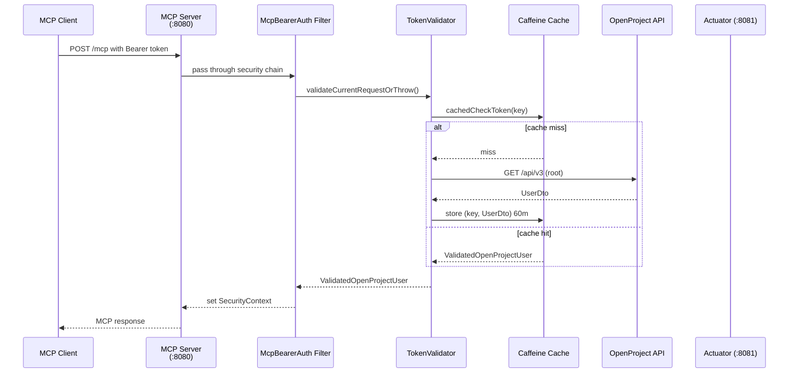
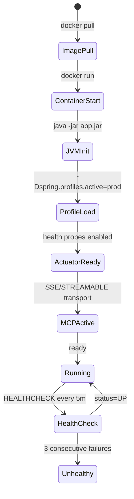

This page describes how the Spring OpenProject MCP Server is built, deployed, and operated as a Docker container. It covers the Dockerfile layout, multi-platform build process with SBOM attestation, health check probes, and the runtime environment variables that govern its behavior.

## Container Image

The Docker image is built from the Eclipse Temurin JRE base image, which provides the Java 25 runtime without a full JDK ([repo://docker/Dockerfile#L1-L3](repo://docker/Dockerfile#L1-L3)). The base image tag is `25.0.4_7-jre-ubi10-minimal` (a minimal UBI 10-based JRE).

The image includes the following labels for provenance ([repo://docker/Dockerfile#L5-L7](repo://docker/Dockerfile#L5-L7)):

| Label | Value |
|-------|-------|
| `org.opencontainers.image.licenses` | `MIT` |
| `org.opencontainers.image.source` | `https://github.com/tmskln/spring-openproject-mcp-server.git` |
| `org.opencontainers.image.description` | `MCP Server for OpenProject API (workpackages)` |

## Build Process

### Multi-Platform Build with SBOM

The recommended build command produces a multi-platform image supporting both `linux/amd64` and `linux/arm64` ([repo://README.md#L45-L56](repo://README.md#L45-L56)):

```bash
PKG_VERSION="dev" && docker build \
  -f docker/Dockerfile \
  -t spring-openproject-mcp-server:${PKG_VERSION} \
  --attest type=sbom,generator=docker/scout-sbom-indexer:latest \
  --label org.opencontainers.image.build-date=$(date -u +"%Y-%m-%dT%H:%M:%SZ") \
  --label org.opencontainers.image.revision=$(git rev-parse HEAD) \
  --label org.opencontainers.image.version=${PKG_VERSION} \
  --platform linux/amd64,linux/arm64 \
  .
```

Key build options:

- **`--attest type=sbom`** — generates an SBOM (Software Bill of Materials) attestation using Docker Scout's SBOM indexer. The SBOM is embedded in the image metadata for vulnerability scanning and supply-chain verification.
- **`--platform linux/amd64,linux/arm64`** — builds a multi-architecture manifest list, enabling deployment on both Intel/AMD64 and ARM64 (e.g., Apple Silicon, AWS Graviton) hosts.
- **OCI labels** — `build-date`, `revision`, and `version` labels are injected at build time for traceability.

### SBOM Pre-Conversion

Before the Docker build, the Maven build produces a CycloneDX SBOM at `target/classes/META-INF/sbom/application.cdx.json`. This can be converted to SPDX JSON format for optimization using the CycloneDX CLI ([repo://README.md#L37-L43](repo://README.md#L37-L43)):

```bash
docker run --rm \
  -v "./target/classes/META-INF/sbom:/work" --platform linux/amd64 \
  cyclonedx/cyclonedx-cli \
  convert \
  --input-file /work/application.cdx.json \
  --output-file /work/application.spdx.json \
  --output-format spdxjson
```

Both the CycloneDX (`.cdx.json`) and SPDX (`.spdx.json`) SBOM files are copied into the Docker image ([repo://docker/Dockerfile#L14-L15](repo://docker/Dockerfile#L14-L15)).

## Dockerfile Layout

The Dockerfile ([repo://docker/Dockerfile](repo://docker/Dockerfile)) follows these steps:

1. **Base image** — `eclipse-temurin:25.0.4_7-jre-ubi10-minimal`
2. **WORKDIR** — `/app`
3. **Copy** — the application JAR as `app.jar`, plus `application-prod.properties` and both SBOM files
4. **Create non-root user** — `spring` system user with group ownership of `/app`
5. **Switch user** — `USER spring:spring` (no root privileges at runtime)
6. **EXPOSE** — port `8080` (HTTP)
7. **HEALTHCHECK** — queries the readiness probe endpoint
8. **ENTRYPOINT** — starts the JVM with `prod` profile active

### Image Contents

| Path in Image | Source |
|---------------|--------|
| `/app/app.jar` | `target/spring-openproject-mcp-server*.jar` |
| `/app/application-prod.properties` | `target/classes/application-prod.properties` |
| `/app/application.cdx.json` | `target/classes/META-INF/sbom/application.cdx.json` |
| `/app/application.spdx.json` | `target/classes/META-INF/sbom/application.spdx.json` |

Note that `application-prod.properties` is placed at the image root (`/app/application-prod.properties`) rather than inside `BOOT-INF/classes`, ensuring it is available even if the Spring Boot classpath layout changes.

## Runtime Configuration

### Profile Activation

The `prod` Spring Boot profile is activated via a JVM system property passed at container start ([repo://docker/Dockerfile#L29](repo://docker/Dockerfile#L29)):

```
java -Dspring.profiles.active=prod -jar /app/app.jar
```

The `prod` profile ([repo://src/main/resources/application-prod.properties](repo://src/main/resources/application-prod.properties)) applies the following overrides:

- Logging: `ERROR` for Spring framework, `INFO` for the application package
- Spring banner disabled
- Actuator endpoints exposed only at `/actuator/health`
- Kubernetes-style readiness/liveness probes enabled (`management.endpoint.health.probes.enabled=true`)
- Disk space and SSL health checks disabled

### Environment Variables

The container accepts two environment variables that control its runtime behavior:

#### `OPENPROJECT_URL` (required)

The base URL of the OpenProject instance the MCP server connects to. Passed at container launch:

```bash
docker run -e OPENPROJECT_URL=https://my-openproject.example.com ...
```

This value is consumed by `HttpHeaderOpenProjectConnectionResolver` as the default base URL when the `X-OpenProject-Base-Url` header override is not enabled ([repo://src/main/resources/application.properties#L22](repo://src/main/resources/application.properties#L22)). The default is `https://localhost` ([repo://src/main/resources/application.properties#L22](repo://src/main/resources/application.properties#L22)).

#### `OPENPROJECT_ALLOW_HEADER_BASE_URL` (optional)

When set to `true`, the server trusts the `X-OpenProject-Base-Url` HTTP header from incoming MCP requests to override the configured base URL. This enables a single MCP server instance to route requests to multiple OpenProject backends dynamically.

```bash
docker run -e OPENPROJECT_ALLOW_HEADER_BASE_URL=true ...
```

When enabled, the MCP client must also supply `X-OpenProject-Base-Url` in its request headers ([repo://README.md#L62-L72](repo://README.md#L62-L72)). The default is `false` ([repo://src/main/resources/application.properties#L23](repo://src/main/resources/application.properties#L23)).

**Security note**: Enabling this feature means any MCP client can redirect API calls to an arbitrary URL. Only enable it in trusted environments.

### No Token Storage

The user's OpenProject API token is passed per-request via the `Authorization: Bearer <token>` header in MCP requests. The token is **never stored in the container** ([repo://README.md#L7](repo://README.md#L7)). It is validated once per request against the OpenProject API and cached for 60 minutes in a Caffeine cache named `auth-validation` ([repo://src/main/resources/application.properties#L6-L8](repo://src/main/resources/application.properties#L6-L8), [repo://src/main/java/de/tklein/tklab/openproject/mcp/security/OpenProjectTokenValidationCache.java](repo://src/main/java/de/tklein/tklab/openproject/mcp/security/OpenProjectTokenValidationCache.java)). The cached key is a SHA-256 hash of `baseUrl|token` — the raw token is never stored ([repo://src/main/java/de/tklein/tklab/openproject/mcp/security/OpenProjectTokenValidator.java#L44-L45](repo://src/main/java/de/tklein/tklab/openproject/mcp/security/OpenProjectTokenValidator.java#L44-L45)).

## Health Check

### Docker HEALTHCHECK

The Dockerfile defines a periodic health check ([repo://docker/Dockerfile#L25-L26](repo://docker/Dockerfile#L25-L26)):

```dockerfile
HEALTHCHECK --interval=5m --timeout=3s --start-period=20s --retries=3 \
  CMD wget -qO- http://127.0.0.1:8081/actuator/health/readiness | grep -q '"status":"UP"' || exit 1
```

Parameters:

| Parameter | Value | Meaning |
|-----------|-------|---------|
| `--interval` | 5m | Check every 5 minutes |
| `--timeout` | 3s | Fail if the command takes more than 3 seconds |
| `--start-period` | 20s | Grace period during container startup; failures during this window don't count toward `--retries` |
| `--retries` | 3 | Mark unhealthy after 3 consecutive failures |

The command queries the Spring Boot Actuator **readiness** endpoint on the management port (8081) and checks for `"status":"UP"` in the response.

### Actuator Endpoint Configuration

The actuator is configured to expose only the health endpoint ([repo://src/main/resources/application-prod.properties](repo://src/main/resources/application-prod.properties)):

- Base path: `/actuator`
- Exposed endpoints: `health` only
- Health details and components hidden (`show-details=never`, `show-components=never`)
- Kubernetes probes enabled (enables `/actuator/health/liveness` and `/actuator/health/readiness`)
- Disk space and SSL health checks disabled

### Security

The actuator endpoint on port 8081 is protected by basic authentication ([repo://src/main/java/de/tklein/tklab/openproject/mcp/security/SecurityConfig.java#L58-L66](repo://src/main/java/de/tklein/tklab/openproject/mcp/security/SecurityConfig.java#L58-L66)):

- URL matcher: `/actuator/**`
- `/actuator/health` and `/actuator/health/*` are **permitted without auth** (so the Docker `HEALTHCHECK` can query them)
- All other actuator paths require the `ACTUATOR_ADMIN` role
- Default credentials: username `admin`, password hash stored in `application.properties` (a placeholder bcrypt hash, not a real password)

The MCP endpoints on port 8080 (`/mcp`, `/sse`) use bearer-token authentication via the `McpBearerAuthenticationFilter` ([repo://src/main/java/de/tklein/tklab/openproject/mcp/security/McpBearerAuthenticationFilter.java](repo://src/main/java/de/tklein/tklab/openproject/mcp/security/McpBearerAuthenticationFilter.java)). This filter validates the `Authorization: Bearer <token>` header against the OpenProject API and is explicitly excluded from global servlet filter registration so it only runs within the Spring Security chain ([repo://src/main/java/de/tklein/tklab/openproject/mcp/security/SecurityConfig.java#L46-L55](repo://src/main/java/de/tklein/tklab/openproject/mcp/security/SecurityConfig.java#L46-L55)).

## Deployment

### Docker Run

The standard deployment command ([repo://README.md#L21-L22](repo://README.md#L21-L22)):

```bash
docker run -d \
  -p 0.0.0.0:8080:8080 \
  -e OPENPROJECT_URL=https://${yourOpenProjectUrl} \
  --tmpfs /tmp \
  docker.io/tmskln/spring-openproject-mcp-server:latest
```

The `--tmpfs /tmp` mount ensures temporary files are not persisted across container restarts.

### Published Images

The latest image is published at [https://hub.docker.com/r/tmskln/spring-openproject-mcp-server](https://hub.docker.com/r/tmskln/spring-openproject-mcp-server).

## MCP Protocol

The MCP server defaults to the **SSE (Server-Sent Events)** protocol ([repo://src/main/resources/application.properties#L18](repo://src/main/resources/application.properties#L18)), which exposes:

- `GET /sse` — server-to-client streaming endpoint
- `POST /mcp/message` — client-to-server message endpoint

Alternatively, the **STREAMABLE** protocol (`spring.ai.mcp.server.protocol=STREAMABLE`) exposes a single bidirectional endpoint (`/mcp`) based on the MCP streamable HTTP spec. Only one protocol can be active at a time because the transport defines the wiring, endpoints, and message routing ([repo://README.md#L79-L88](repo://README.md#L79-L88)).

## OpenProject Compatibility

The server has been tested against OpenProject versions 14, 15, 16.6, and 17.7 ([repo://README.md#L11](repo://README.md#L11)). The application uses direct JSON value mapping with MapStruct rather than a generated OpenAPI client, which provides better compatibility across OpenProject API version differences ([repo://README.md#L93-L103](repo://README.md#L93-L103)).

## Request Flow



## Startup Lifecycle



## Integration Testing

Integration tests run against a real OpenProject container ([repo://README.md#L74-L76](repo://README.md#L74-L76)):

```bash
mvn test -Dopenproject.container.tag=17.5.1 -Dopenproject.container.port=18080
```

Tests use the `STREAMABLE` protocol to avoid leaving open SSE streams during teardown ([repo://src/test/java/de/tklein/tklab/openproject/mcp/tools/McpPingIntegrationTest.java#L22](repo://src/test/java/de/tklein/tklab/openproject/mcp/tools/McpPingIntegrationTest.java#L22)). Volumes should be removed between test runs to avoid state leakage.
