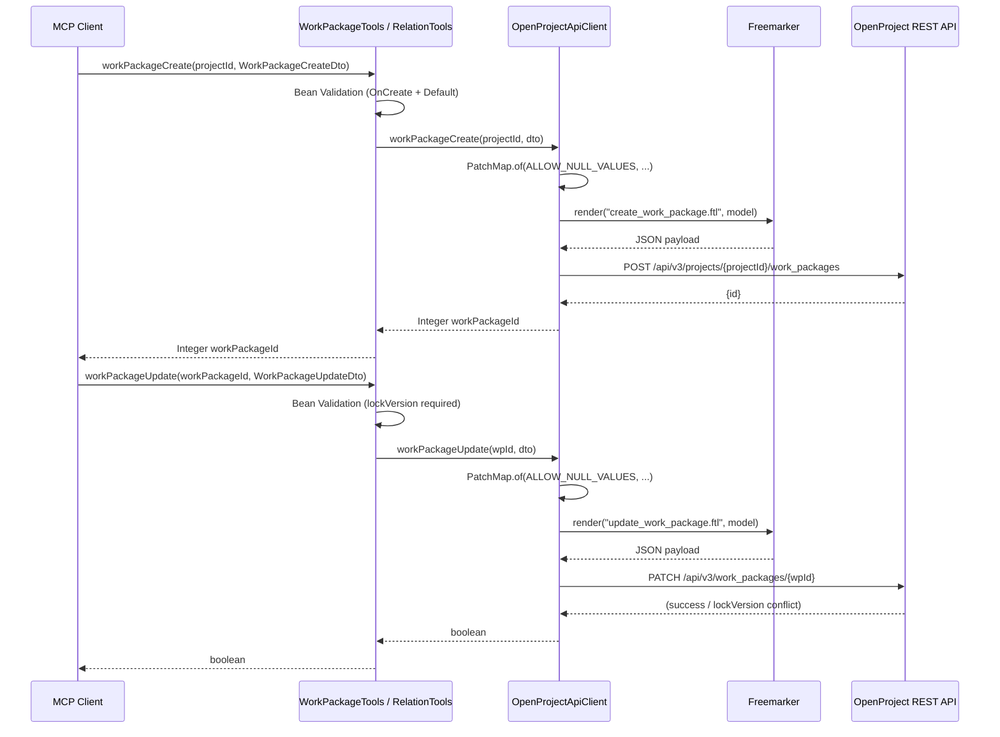
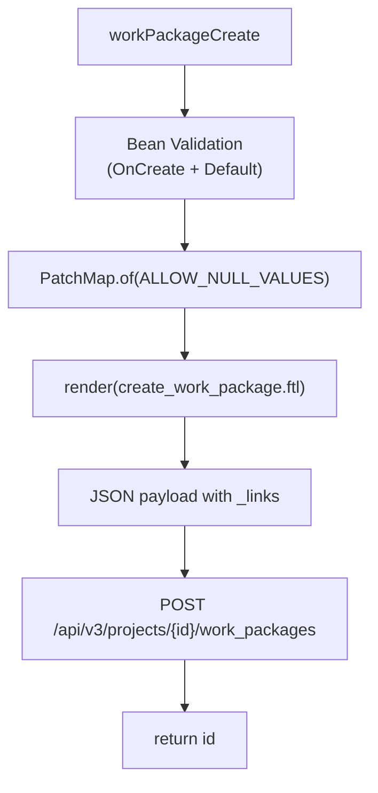
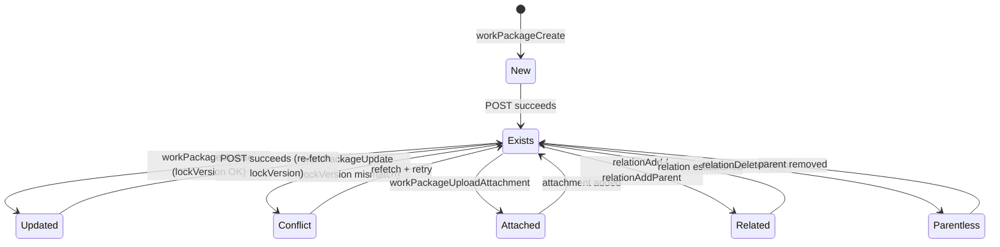

# Work Package Lifecycle

This page traces how the OpenProject MCP server creates, updates, and manages
work packages through its tool layer, covering validation, payload rendering,
optimistic locking, attachment upload, and parent/child relation handling.

## Architecture Overview

Work package operations flow through three layers:

1. **MCP Tool layer** (`WorkPackageTools`, `RelationTools`) — receives tool
   calls from MCP clients, applies Bean Validation, delegates to the API client.
2. **API client** (`OpenProjectApiClient`) — builds data models via `PatchMap`,
   renders Freemarker templates into JSON payloads, and dispatches HTTP requests
   to the OpenProject REST API.
3. **OpenProject REST API** — persists work packages, enforces server-side
   constraints, and returns JSON responses.



## DTOs and Validation

### WorkPackageCreateDto

Used as the input contract for creation. Validated with `@Validated({OnCreate.class, Default.class})` on the tool method, which activates two constraint groups:

- **OnCreate group**: `subject` is `@NotBlank`, `typeId` is `@NotNull`.
- **Default group**: `storyPoints` is `@Positive` (if present).

All other fields (`description`, `priorityId`, `startDate`, `dueDate`, `estimatedTime`) are optional.

### WorkPackageUpdateDto

Extends `WorkPackageCreateDto` and adds one required field:

- **lockVersion**: `@NotNull` — the latest lock version from the server-side
  work package state. This field is **not** inherited from the superclass; it
  is declared explicitly on the subclass to avoid validation ambiguity.

The `subject` and `typeId` fields are overridden on the subclass with plain
`@JsonProperty` (no `required = true`), making them optional for updates — only
the fields actually present in the request payload are sent to the server.

### WorkPackageDto

The read-side DTO returned from the API. Contains `id`, `lockVersion`,
`subject`, `description`, `storyPoints`, `startDate`, `dueDate`, `estimatedTime`,
`duration`, `createdAt`, `updatedAt`, `type`, `priority`, and `href`.

### RelationDto

Represents a relation reference (including derived `parent`, `children`,
`ancestors` types). Fields: `id` (null for derived relations), `type`,
`description`, `toId`, `to` (title).

## Create Flow

The `workPackageCreate` MCP tool accepts a `projectId` and a `WorkPackageCreateDto`, applies Bean Validation, then delegates to `OpenProjectApiClient.workPackageCreate()`.

1. **Model building**: `PatchMap.of(ALLOW_NULL_VALUES, ...)` creates a map of
   template variables from the DTO fields, preserving `null` values so the
   template can emit explicit `null` JSON.
2. **Template rendering**: `create_work_package.ftl` produces a complete JSON
   payload with:
   - `subject` (required)
   - `scheduleManually: true` (enables manual date management)
   - `startDate`, `dueDate`, `estimatedTime`, `storyPoints` (conditional —
     null if absent)
   - `duration: null` (explicitly set)
   - `_links.type` → `/api/v3/types/{typeId}`
   - `_links.priority` → conditional, only if `priorityId` is present
   - `_links.project` → `/api/v3/projects/{projectId}`
   - `_links.status` → hardcoded to `/api/v3/statuses/1`
   - `_links.parent` → `{href: null}`
   - `description.raw` (empty string if absent, via `!json_string`)
3. **POST** to `/api/v3/projects/{projectId}/work_packages`
4. **Returns** the `id` from the response JSON.



## Update Flow

The `workPackageUpdate` MCP tool accepts a `workPackageId` and a
`WorkPackageUpdateDto`, validates it, and delegates to
`OpenProjectApiClient.workPackageUpdate()`.

1. **Model building**: `PatchMap.of(ALLOW_NULL_VALUES, ...)` includes
   `lockVersion` and all DTO fields.
2. **Template rendering**: `update_work_package.ftl` produces a **partial** JSON
   payload:
   - `lockVersion` (always emitted — required for optimistic locking)
   - `_links.type` and `_links.priority` (conditional, only when present)
   - `subject`, `description.raw`, `startDate`, `dueDate`, `estimatedTime`,
     `storyPoints` (all conditional, only emitted when present)
   - `_meta.validateCustomFields: true` (signals server-side custom field validation)
3. **PATCH** to `/api/v3/work_packages/{workPackageId}`

The lock version is the critical invariant: the client must supply the latest
`lockVersion` from the server. If the server's current version differs, the
update fails with a conflict response.

## Attachment Upload

The `workPackageUploadAttachment` MCP tool accepts `workPackageId`, `fileName`,
`fileContentBase64`, and `fileContentType`:

1. **Base64 decode** — throws `IllegalArgumentException` if the input is not
   valid Base64.
2. **Multipart body** — `restOperations.buildMultipartAttachmentBody()` wraps
   the decoded bytes into a multipart/form-data request.
3. **POST** to `/api/v3/work_packages/{wpId}/attachments`
4. **Returns** the attachment `id`.

## Parent and Child Relations

### Adding a Parent

`RelationTools.relationAddParent(workPackageId, parentWorkPackageId)` performs an
in-band parent relation by patching the target work package:

1. **Fetch** the current work package via `GET /api/v3/work_packages/{wpId}`
   to read the latest `lockVersion`.
2. **Build model** with `PatchMap.of(ALLOW_NULL_VALUES, "lockVersion", ...,
   "parentHref", WP_PREFIX + parentId)`.
3. **Render** `update_parent_relation.ftl`, which emits:
   ```json
   {
     "lockVersion": <current>,
     "_links": {
       "parent": { "href": "/api/v3/work_packages/{parentId}" }
     }
   }
   ```
4. **PATCH** to `/api/v3/work_packages/{workPackageId}`.

### Deleting a Parent

`RelationTools.relationDeleteParent(workPackageId)` follows the same pattern but
sets `parentHref` to `null`, causing the template to emit:

```json
{
  "lockVersion": <current>,
  "_links": {
    "parent": { "href": null }
  }
}
```

### General Relations

`RelationTools.relationAdd()` creates a typed relation between two work packages
via `POST /api/v3/work_packages/{wpId}/relations`, rendering
`create_parent_relation.ftl` to produce a JSON payload with `type`,
`description`, and `_links.to.href`.

`RelationTools.relationDelete()` removes a relation by `DELETE
/api/v3/relations/{relationId}`. On failure (e.g., 404), it logs a warning and
returns `false` rather than throwing.

### Listing Relations

`OpenProjectApiClient.listRelationsForWorkPackage()` assembles the complete
relation set from four sources:

1. **Explicit relations** — from `_embedded.relations._embedded.elements[]` in
   the work package JSON, mapped via `RelationMapper.fromRelationElement()`.
2. **Parent** — derived from `_links.parent`, mapped via
   `RelationMapper.fromWpLink("parent", ...)`.
3. **Children** — derived from `_links.children[]`, mapped via
   `RelationMapper.fromWpLink("children", ...)`.
4. **Ancestors** — derived from `_links.ancestors[]`, mapped via
   `RelationMapper.fromWpLink("ancestors", ...)`.

Derived relations (`parent`, `children`, `ancestors`) have `id = null` because
they are inferred from links, not stored as explicit relation records.

<!-- openwiki: mermaid parse failed and this diagram was converted to a text fence so it does not break rendering. Fix the diagram source and restore the mermaid fence. Parser error: Heuristic: an unescaped angle bracket inside a label breaks rendering; rephrase the label. -->
```text
flowchart TD
    A["listRelationsForWorkPackage"] --> B["GET /api/v3/work_packages/{wpId}"]
    B --> C["_embedded.relations\n_explicit relations_"]
    B --> D["_links.parent\n_derived parent_"]
    B --> E["_links.children[]\n_derived children_"]
    B --> F["_links.ancestors[]\n_derived ancestors_"]
    C --> G["Collection<RelationDto>"]
    D --> G
    E --> G
    F --> G
```

## PatchMap Utility

`PatchMap` is a map-creation utility with null-value filtering. It supports two
modes:

- **`ALLOW_NULL_VALUES`**: includes entries where the value is `null` (used for
  work package creation and updates, where explicit `null` must appear in the
  JSON payload).
- **`DROP_NULL_VALUES`**: skips entries with `null` values (used for general
  patch scenarios where absent keys mean "no change").

The constructor validates that the alternating key-value argument count is even.

## Safe Edit Prompt

`WorkPackageTools.safeEditWorkPackagePrompt` provides a structured,
human-in-the-loop workflow for safe work package modifications:

1. **Fetch** the current work package state.
2. **Prepare a diff** showing old vs. new values for all affected fields.
3. **Ask for explicit confirmation** ("Yes, apply", "Confirm", "Proceed").
4. **Execute** `work_package_update` with the latest `lockVersion`.
5. **Reload** after any update before performing further changes.

Key protocol rules enforced by the prompt:

- **Markdown newlines**: represent line breaks as the literal two-character
  sequence `/n` in proposed text (not `\\n`).
- **LockVersion staleness**: after any update, treat the local state as stale
  and always refetch before subsequent changes.
- **Diff before update**: the unified diff must be presented before any
  `work_package_update` call.
- **No silent updates**: updates never apply without explicit user confirmation.

## Validation Failures

| Tool Method | Constraint Violation |
|---|---|
| `workPackageList` | `projectId` is null |
| `workPackageShow` | `workPackageId` is null |
| `workPackageCreate` (no dto) | `projectId` and `workPackage` are null |
| `workPackageCreate` (empty dto) | `subject` is blank, `typeId` is null |
| `workPackageUpdate` (no dto) | `workPackageId` and `workPackage` are null |
| `workPackageUpdate` (empty dto) | `lockVersion` is null |
| `workPackageUploadAttachment` | any of the four params is null |

All validation failures throw `ConstraintViolationException` with property path
identifiers like `workPackageCreate.workPackage.subject` for debugging.

## Tests

Unit tests in `WorkPackageToolsTest` cover:

- **Validation exceptions**: each tool method is tested with null and empty
  DTOs to verify the exact constraint violation property paths.
- **Safe edit prompt**: verifies the prompt contains the correct inputs, the
  `/n` newline directive, the diff + confirmation workflow description, and
  the `OpenProject Work Package Safe Edit` title.

Integration tests in `OpenProjectApiClientIntegrationTest` run against a real
OpenProject Docker container (tagged `@Tag(INTEGRATION_TEST_REMOTE)`):

- **`workPackageShow` with non-existent ID**: returns `null` (not a 404
  exception) — the client swallows 404s for work package lookups.
- **`relationDelete` with non-existent ID**: returns `false` (not an
  exception) — the client catches and logs the error internally.
- **`initIds`**: verifies `root()`, `projectList()`, `typeList()`, and
  `priorityList()` work during test setup to establish the demo project ID,
  type ID, and priority ID.

## State Diagram

The work package lifecycle across the MCP tool layer can be summarized as:


